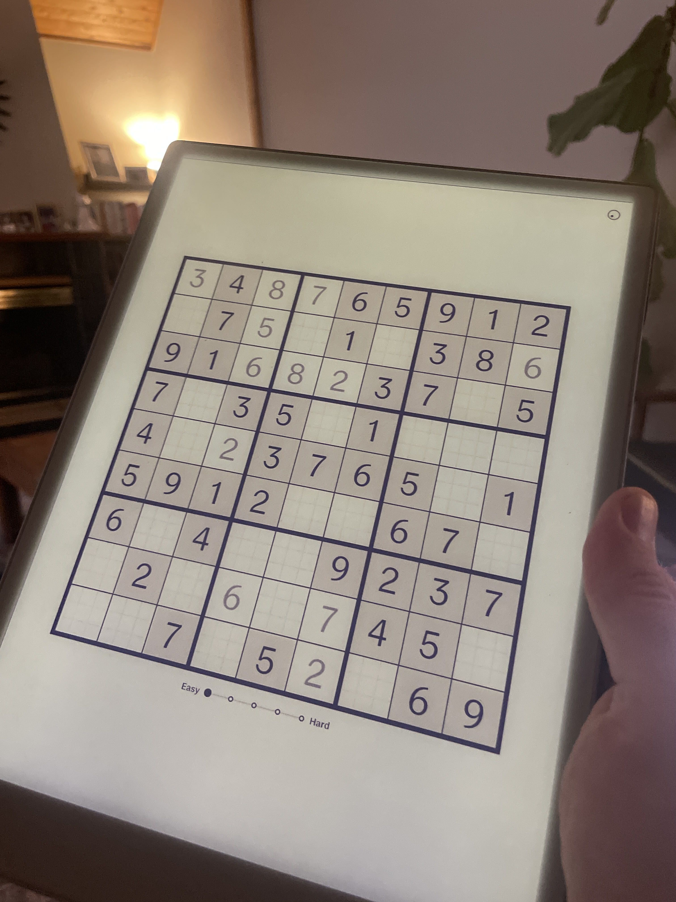
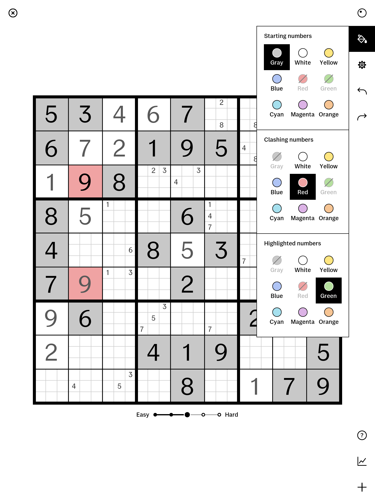

# Sudoku for reMarkable Paper Pro

This document is written in ASD-STE100 Simplified Technical English (STE).

Sudoku is an open-source puzzle application for the reMarkable Paper Pro tablet. The application runs as an AppLoad external application with a `qtfb` framebuffer.

<p align="center">
  
  
</p>

## What It Is

The application provides a full Sudoku game designed for the color e-ink display of the reMarkable Paper Pro (1620×2160 portrait, 2160×1620 landscape, 229 DPI).

Main features:
- **Pen handwriting input**: Write a digit (1 to 9) in a cell. The $P point-cloud recognizer reads your stroke.
- **Pen pencil marks**: Tap a micro-cell with the pen tip to add or remove a pencil mark.
- **Marker eraser support**: Rub a cell with the marker eraser to clear numbers and pencil marks.
- **Touch controls**: Use your finger to operate menus, buttons, and difficulty sliders.
- **Live ink**: The screen shows strokes immediately while you write.
- **Puzzle generator**: Creates puzzles with 5 difficulty levels (Easy, Medium, Hard, Expert, Master). Each puzzle has only one solution.
- **Smart helpers**: Automatic pencil mark cleanup, duplicate number clash detection (red), and number highlight overlays (green).
- **Undo and redo**: Full history support for all board moves.
- **Built-in manual**: A 9-page guide that explains how to play and how to use the tablet controls.
- **Analytics and statistics**: Tracks completed games, times, and difficulty metrics in a local SQLite database.
- **State persistence**: Saves the current game, elapsed time, and custom settings automatically when you pause or close the app.
- **System font integration**: Loads and uses the native `reMarkable Sans` font directly from the tablet.

## How This Application Was Built

Claude designed and wrote this entire application through a process called **"Fake Screenshot Driven Development"**.

### 1. Fake Screenshot Driven Development

Before Claude wrote a single line of Rust code:
1. Claude generated simulated ("fake") screenshots of the entire application.
2. These screenshots defined every screen state, toolbar panel, and dialog.
3. Claude also generated 9 complete pages of a visual user "manual" that explained how the application works.
4. Shell and Python scripts (`scripts/build.sh`) made these exact 1620×2160 reference images in the [`images/`](images/) directory.

Refer to [`images/INDEX.md`](images/INDEX.md) for the list of reference images.

### 2. Specification Generation

From that conversation and the reference screenshots, Claude generated two formal specification documents:
- [`REQUIREMENTS.md`](REQUIREMENTS.md): Specifies all screens, layout dimensions, user inputs, visual elements, and persistent data formats.
- [`INVARIANTS.md`](INVARIANTS.md): Specifies all formal state invariants and rules that must hold true in every reachable application state.

### 3. Implementation and Verification

Claude wrote the entire application code in Rust:
- **State invariants**: The application verifies the rules from [`INVARIANTS.md`](INVARIANTS.md) after each user input.
- **Visual tests**: Snapshot tests ([`tests/render.rs`](tests/render.rs)) compare rendered screens with the reference screenshots pixel by pixel.
- **Device verification**: Device logs and hardware tests confirmed ink latency, eraser detection, and AppLoad integration ([`DECISIONS.md`](DECISIONS.md)).

## How to Build

### Requirements
- **Rust toolchain** (to run tests locally on macOS or Linux)
- **Docker** (to build the aarch64 Linux executable for the reMarkable Paper Pro)

### Run Tests on Your Computer

Run the test suite on your local machine:

```bash
cargo test
```

To compare rendered states with the reference images in [`images/`](images/):

```bash
cargo run --release --bin snapshot -- images/
```

### Build for the reMarkable Paper Pro

Use the Dockerfile of the project to compile the static binary for `aarch64` Linux:

```bash
docker build --platform linux/arm64 --output type=local,dest=dist .
```

This command makes the `dist/sudoku/` folder. The folder contains:
- `sudoku`: The compiled static Linux binary.
- `external.manifest.json`: The AppLoad configuration manifest.
- `icon.png`: The application icon for the AppLoad launcher.

## How to Install on the reMarkable

### Prerequisites
1. Enable developer mode on your reMarkable Paper Pro.
2. Set up SSH access to the tablet.
3. Install AppLoad on the tablet (for example, with Vellum: `vellum add appload`).

### Installation Steps

1. Copy the `dist/sudoku` folder to the AppLoad directory on your tablet:

```bash
scp -r dist/sudoku root@10.11.99.1:/home/root/xovi/exthome/appload/
```

> [!NOTE]
> Replace `10.11.99.1` with the IP address of your tablet if you connect through Wi-Fi.

2. Make sure that the binary has executable permissions:

```bash
ssh root@10.11.99.1 "chmod 755 /home/root/xovi/exthome/appload/sudoku/sudoku"
```

3. Open the AppLoad launcher on your tablet.
4. Tap **Sudoku** to start the application.

## Data Storage

The application keeps its data in `/home/root/.local/share/remarkable-sudoku/` on the tablet:
- `game.json`: The active game state, board history, and elapsed clock time.
- `settings.json`: The user settings (such as cell color selections).
- `results.db`: The SQLite database of completed games and completion times.

## Contributing

We welcome your contributions. We look for help in these areas:

- **Puzzle generation algorithm**: Improvements to [`src/generator.rs`](src/generator.rs). Examples include better difficulty ratings, faster generation, or improved clue patterns. Each puzzle must keep exactly one valid solution (`PUZ-2`).
- **Bug fixes**: Fixes for reported software defects, device edge cases, or drawing errors.

### Guidelines

1. Write all text, comments, and messages in ASD-STE100 Simplified Technical English (STE). Use US spelling.
2. Make sure that your changes follow [`REQUIREMENTS.md`](REQUIREMENTS.md) and [`INVARIANTS.md`](INVARIANTS.md).
3. Run the test suite on your computer:
   ```bash
   cargo test
   ```

## License

MIT
