# Sudoku for reMarkable Paper Pro — Requirements

This document is written in ASD-STE100 Simplified Technical English (STE).

This document tells what the app does. It gives the screens, all the states, all the inputs and the
results of the inputs, and the data that the app keeps.

The images in [`images/`](images/) show each state exactly. The script
[`scripts/build.sh`](scripts/build.sh) makes the images. The file
[`images/INDEX.md`](images/INDEX.md) gives a list of the images.

If a behavior is not known yet, it is in [Open questions](#16-open-questions). The body of this
document does not include unknown behavior.

## Contents

1. [Device and display](#1-device-and-display)
2. [Screens](#2-screens)
3. [The game screen](#3-the-game-screen)
4. [Cells](#4-cells)
5. [Pen and touch input](#5-pen-and-touch-input)
6. [Helpers: pencil mark removal, highlights, clashes](#6-helpers-pencil-mark-removal-highlights-clashes)
7. [Undo and redo](#7-undo-and-redo)
8. [Puzzle states and the clock](#8-puzzle-states-and-the-clock)
9. [The menu](#9-the-menu)
10. [Cell colors panel](#10-cell-colors-panel)
11. [New game panel and difficulty](#11-new-game-panel-and-difficulty)
12. [Manual (Help)](#12-manual-help)
13. [Statistics](#13-statistics)
14. [Data that the app keeps](#14-data-that-the-app-keeps)
15. [Visual specification](#15-visual-specification)
16. [Open questions](#16-open-questions)
17. [Image reference](#17-image-reference)

---

## 1. Device and display

- The target device is the **reMarkable Paper Pro**. It has a color e-ink display of 1620×2160 px
  (portrait) at 229 DPI and a 64-bit ARM processor.
- Build the executables in the Linux Dockerfile of the project. Refer to `AGENTS.md`.
- The app operates in portrait and in landscape (2160×1620). When the tablet turns, AppLoad tells the
  app the rotation, and the app shows its landscape layout. Refer to [§3.3](#33-landscape).
- [`images/template.png`](images/template.png) is the blank 1620×2160 frame for all screens.
- The display can show color. All states must be clear if the e-ink display dithers the colors.
- The UI font is **reMarkable Sans**, the font of the device. The app loads the font from the tablet
  when the app starts (`/usr/share/remarkable/webui/reMarkableSans.woff2`). The app does not include a
  copy of the font.

## 2. Screens

The app has four screens. The game screen also has a menu with three panels. Refer to
[§9](#9-the-menu).

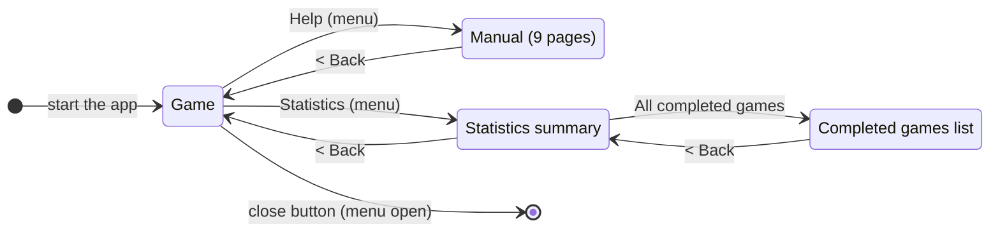

| Screen | Images |
|---|---|
| Game | [`screen.png`](images/screen.png), [`screen-in-progress.png`](images/screen-in-progress.png), [`screen-completed.png`](images/screen-completed.png) and the menu images in §9 |
| Manual | [`manual-how-to-play.png`](images/manual-how-to-play.png) to [`manual-finished.png`](images/manual-finished.png) (§12) |
| Statistics summary | [`analytics.png`](images/analytics.png) |
| Completed games list | [`analytics-games.png`](images/analytics-games.png), [`analytics-delete.png`](images/analytics-delete.png) |

## 3. The game screen

Image: [`images/screen.png`](images/screen.png) (empty board, menu closed).

### 3.1 Layout

| Item | Position and size | Notes |
|---|---|---|
| Board | 9×9 cells of **147 px**; x 148–1471, y 418–1741 (at the center of the screen) | Lines of 12 px are around the board and the 3×3 boxes. Lines of 3 px are between the cells. |
| Micro-cells | Each cell has a faint 3×3 grid of **49 px** micro-cells (2 px lines, light gray) | Each micro-cell is for one digit. The positions are the same as a keypad: 1 2 3 / 4 5 6 / 7 8 9. |
| Difficulty meter | Below the board, at the center, 50 px from the board | The player cannot change it. It shows "Easy", seven stops and "Hard". The large knob shows the mode of the current puzzle. When the puzzle is complete, "Completed in …" replaces the meter. |
| Menu button | Top right, circle of 38 px, center at (1563.5, 55.5) | Closed icon: dot at the bottom left. Open icon: dot at the top left. Both icons are copies from the device. |
| Close button | Top left, circle of 38 px with ×, center at (55.5, 55.5) | The close button shows **only when the menu is open**. The device does the same. |

The open menu starts at x 1508. The board ends at x 1471. Thus the open menu does not cover the board
(gap of 37 px).

The positions above are for a **left-handed** player. The app reads the handedness of the device
(`RightHanded` in `[General]` of `/home/root/.config/remarkable/xochitl.conf`) when it starts. For a
**right-handed** player (`RightHanded=true`, or no value), the menu is at the other side:

- The toolbar is at the left edge (x 0–112). The menu button is at the top left, center (55.5, 55.5).
  Its icon is a mirror image (the dot is at the right).
- The close button is at the top right, center (1563.5, 55.5).
- The panels touch the toolbar at its right side (for example, Cell colors at x 112–511).
- The other icons and the contents of the panels do not change.

The board, the meter, the manual and the statistics do not change.

Image: [`images/color-menu-right-handed.png`](images/color-menu-right-handed.png) (the Cell colors
panel of `color-menu.png` for a right-handed player).

[`images/box.png`](images/box.png) shows one 3×3 box. [`images/cell.png`](images/cell.png) shows one
cell with its micro-cells. Both images use the scale of the board and have 20 px of space around them.

### 3.2 Game screen states

The game screen has three independent parts:

- The **puzzle state** (§8).
- The **menu state** (§9).
- A **temporary overlay** on the board: a highlight or a "?".

Overlays occur only when the puzzle is in progress. A completed puzzle does not show overlays.
**All actions** remove a highlight. Actions include a pen tap or stroke, a finger touch and a tap on a
menu button.

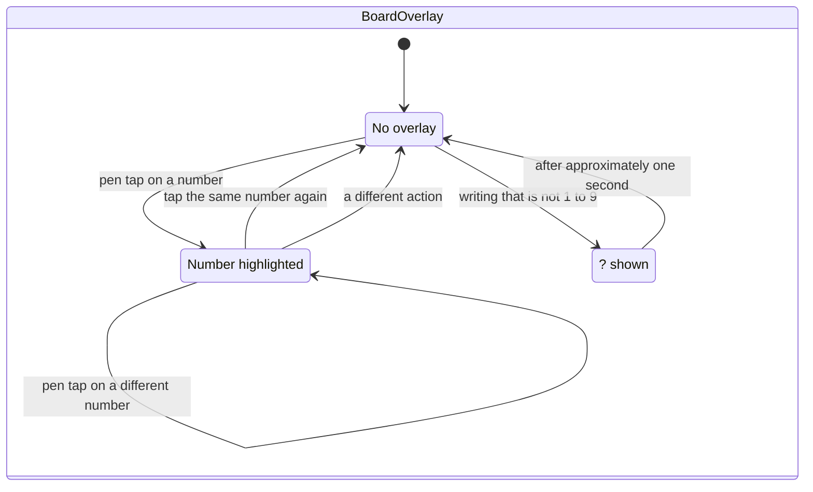

| Overlay | Image |
|---|---|
| No overlay | [`screen-in-progress.png`](images/screen-in-progress.png) |
| Number highlighted | [`screen-highlight.png`](images/screen-highlight.png) |
| "?" shown | [`screen-unrecognized.png`](images/screen-unrecognized.png) |

### 3.3 Landscape

The landscape layout has the same items, at the same sizes, as the portrait layout:

| Item | Landscape position |
|---|---|
| Board | At the center: x 418–1741, y 148–1471. The difficulty meter is 50 px below the board. |
| Menu | The toolbar is at the right edge (x 2048–2160). Bottom slot 0 starts at y 1508; the top slots start at y 0. The panels touch the toolbar, as in portrait. |
| Close button | Top left, as in portrait. For a right-handed player, the toolbar is at the left edge (x 0–112) and the close button is at the top right (§3.1). |
| Manual | Each page has a landscape version with two columns (`manual-*-landscape.png`, made by `scripts/manual-*-landscape.sh`). The text is the same as in portrait. |
| Statistics | The same scale as in portrait, across the full width. The games list is one table across the full width. Each page shows 6 games, because the height is too small for 12. When the tablet turns, the list shows the page with the first game of the page before the turn. The delete dialog is at the center (`analytics-landscape.png`, `analytics-games-landscape.png`, `analytics-delete-landscape.png`, made by `scripts/analytics.py`). |

When the tablet turns, the game does not change. Ink that waits for the recognition pause and touches
in progress are removed, because their positions are not correct after the turn.

## 4. Cells

### 4.1 Types of cell

Each cell is always one of these four types:

| Type | Appearance | Changes |
|---|---|---|
| **Starting number** | Black digit. No micro-cells. Background: refer to [§4.2](#42-cell-background-color). | It does not change. Writing on it and the eraser have no effect. |
| **Your number** | Dark gray digit. No micro-cells. Background: refer to [§4.2](#42-cell-background-color). The app keeps its pencil marks but does not show them. | Only the eraser or undo can remove it. Writing on it has no effect. |
| **Empty, no pencil marks** | The faint 3×3 grid of micro-cells. | Tap to add a pencil mark. Write to add a number. |
| **Empty, with pencil marks** | The grid of micro-cells with small digits in their keypad positions. | Tap to add or remove a pencil mark. Write to add a number. |

Digits use reMarkable Sans Regular: 104 px for numbers and 31 px for pencil marks. Starting numbers
are black. Your numbers are dark gray (`gray35`).

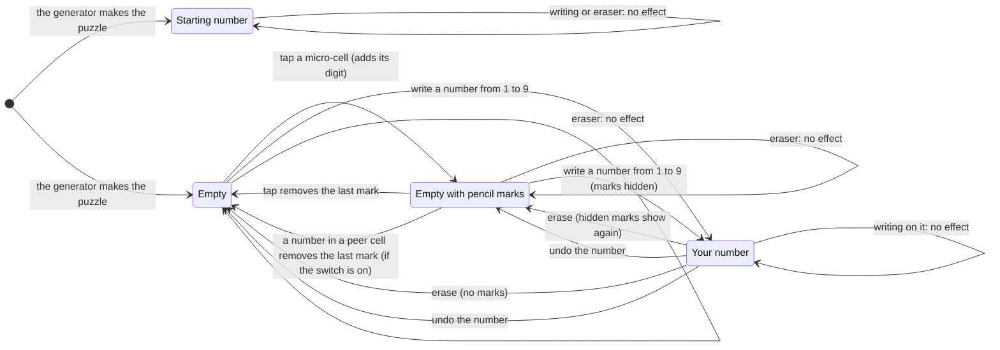

### 4.2 Cell background color

The app uses the first rule that applies:

1. **Clash.** The number clashes ([§6.3](#63-clashes)): clash color (default: red).
2. **Highlight.** The number is the highlighted digit ([§6.2](#62-highlights)): highlight color
   (default: green).
3. **Starting number:** starting-number color (default: gray).
4. All other cells: white.

The player selects the three colors in the Cell colors panel ([§10](#10-cell-colors-panel)).

## 5. Pen and touch input

### 5.1 Rules

- **Finger touches on the board have no effect.** Only the reMarkable pen operates the board.
- A finger can operate all items that are not on the board: the menu buttons, the panels, the dialogs
  and the screen buttons (for example "< Back"). The pen can also operate these items.
- In the manual and the games list, a finger swipe turns the page. Refer to [§12](#12-manual-help) and
  [§13](#13-statistics).
- A **tap** is a pen touch that stays in one micro-cell from start to end. If the pen moves out of the
  micro-cell before it lifts, the touch is writing, not a tap.
- **Writing** is a pen stroke that is not a tap. The app collects the strokes in one cell until the
  pen is lifted for a **short pause (approximately 0.5 s, adjustable)**. Thus a number with more than
  one stroke (for example 4, 5 or 7) is correct.
- After the pause, the app reads all of the strokes as one item. Neat handwriting is not necessary.
  The app removes the ink and shows the typed number.
- **Accuracy target** (confirmed 2026-10-25): for writers that are not in the examples of the
  recognizer, the app reads 96 % or more of the digits correctly and reads 1.2 % or less as a
  different digit. The other digits show the "?". The test `writer_independent_accuracy` examines this
  target.
- If the writing is **not a number from 1 to 9**, the app shows a gray **?** in the cell for
  **approximately one second**. Examples are a scribble, a letter, 0 or a number more than 9, such as
  12. After the "?", the cell is the same as before.
- Writing on a **starting number** or on **your number** has no effect. The app removes the ink. To
  change your number, erase it first.
- The **eraser** is the other end of the pen. When you rub it on your number, the app removes the
  number. The micro-cells and the pencil marks of that cell show again.
- The eraser has no effect on other cells. It does not change starting numbers. It does not change
  empty cells. Only a tap or a new number (automatic removal, §6.1) removes a pencil mark.
- Pen input on a completed puzzle has no effect ([§8](#8-puzzle-states-and-the-clock)).

Images: [`manual-candidates.png`](images/manual-candidates.png),
[`manual-pen.png`](images/manual-pen.png), [`manual-pen-rules.png`](images/manual-pen-rules.png),
[`screen-unrecognized.png`](images/screen-unrecognized.png).

### 5.2 Input decisions

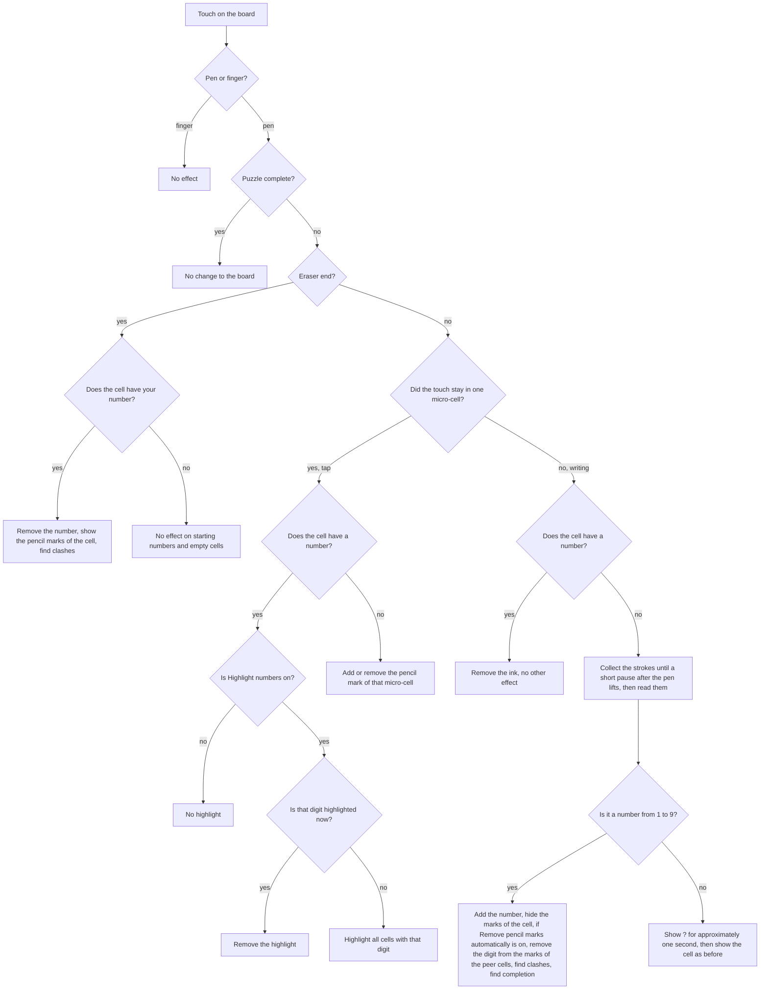

Each action also removes a highlight before the app does the action. A tap on a different number
then makes a new highlight.

## 6. Helpers: pencil mark removal, highlights, clashes

### 6.1 Automatic pencil mark removal

When you add a number, the app removes that digit from the pencil marks of all other cells in the same
row, column and 3×3 box. This includes the hidden marks of cells that have a number. Thus, if you
erase one of those numbers, an incorrect mark does not show again. Undo of the number puts all of
those marks back. Image: [`manual-helpers.png`](images/manual-helpers.png) (top).

- The app removes marks **only when you add a number**. If you add a mark later for a digit that is
  already in the row, column or box, the mark stays. The app does not compare pencil marks with the
  board. Only a tap removes such a mark.
- **The eraser does not put marks back.** When you erase a number, the app shows only the hidden marks
  of that cell. Marks that the number removed from other cells come back only with undo.
- The player can turn automatic removal off in the Settings panel ([§9.1](#91-settings-panel)). Then a
  new number does not change the marks of other cells.

### 6.2 Highlights

Tap a number with the pen (a starting number or your number). The app then gives the highlight color
(default: green) to all cells with that digit.

- If you tap the same digit again, the app removes the highlight.
- If you tap a different number, the highlight moves to the new digit.
- **All other actions** remove the highlight: a pen tap or stroke, a finger touch, or a tap on the
  menu button.
- A completed puzzle does not show highlights.
- The player can turn highlights off in the Settings panel ([§9.1](#91-settings-panel)). Then a tap on
  a number does not make a highlight.

Images: [`screen-highlight.png`](images/screen-highlight.png),
[`manual-helpers.png`](images/manual-helpers.png) (bottom).

### 6.3 Clashes

Two numbers **clash** when the same digit is two times in a row, column or 3×3 box. All numbers in a
clash get the clash color (default: red). This applies to the two numbers of a pair, starting
numbers and your numbers.

- The app finds the clashes again after each new number, erasure, undo and redo.
- When there is no clash, the app removes the clash color.
- The app shows only clashes. It does not compare your numbers with the solution. Thus a number can
  be incorrect and not red.

Images: [`screen-in-progress.png`](images/screen-in-progress.png) (two 9s in column 2),
[`manual-mistakes.png`](images/manual-mistakes.png).

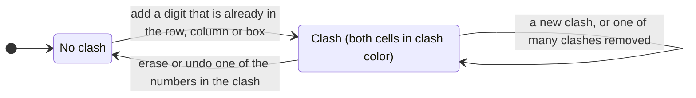

## 7. Undo and redo

- **Undo** cancels the last change to the board. **Redo** makes the last canceled change again.
- These changes are a part of undo:
  - Add or remove a pencil mark.
  - Add a number. This change includes the pencil marks that the number removed.
  - Erase a number.
- These actions are not changes to the board and are not a part of undo: highlights, the "?",
  color changes, switch changes, and the panels and screens that you open.
- A new change after an undo removes the redo history.
- A new game removes the undo history and the redo history.
- The buttons are **black** when an undo or redo is available. They are **gray** when it is not
  available. Gray buttons have no effect. On a completed puzzle, both buttons are gray and have no
  effect.

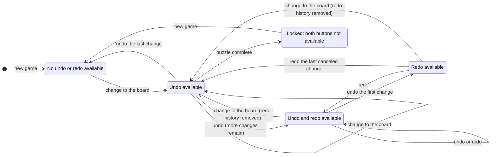

## 8. Puzzle states and the clock

### 8.1 States

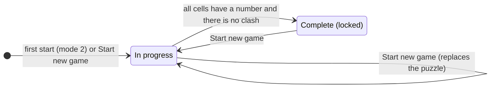

### 8.2 In progress

Images: [`screen.png`](images/screen.png) (a new puzzle, shown empty to show the layout),
[`screen-in-progress.png`](images/screen-in-progress.png).

### 8.3 Complete

A puzzle is **complete** when all cells have a number and there is no clash. Then:

- The text **"Completed in m:ss"** replaces the difficulty meter below the board. After one hour, the
  format is `h:mm:ss`. The text uses the UI font and is at the position of the meter.
- The board **locks**. Writing, the eraser, pencil marks, highlights, undo and redo have no effect.
  The undo and redo buttons are gray.
- The app saves the result in the database ([§14](#14-data-that-the-app-keeps)).
- **+** and **Start new game** continue to operate. The Settings panel continues to operate.

Images: [`screen-completed.png`](images/screen-completed.png),
[`screen-completed-menu.png`](images/screen-completed-menu.png),
[`manual-finished.png`](images/manual-finished.png).

### 8.4 The clock

The clock measures the time that the player uses for the current puzzle. The app does not show the
clock during the game.

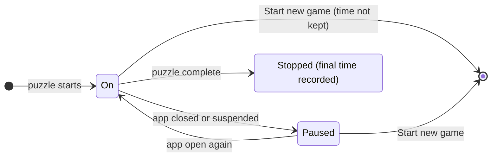

The clock operates only when the app is open. This includes the time when the manual or the statistics
screens are open.

## 9. The menu

The menu is a toolbar of the reMarkable type. It is a column of 112 px at the right edge (x 1508–1620).
For a right-handed player, it is at the left edge (x 0–112) and the close button is at the top right
([§3.1](#31-layout)).
Each button has a slot of 112 px. The icons are 40 px line icons with 3 px strokes.

| Slot | Button | Icon | Action |
|---|---|---|---|
| top 0 | Menu | Circle with a dot (bottom left: closed, top left: open) | Opens and closes the menu. |
| top 1 | Cell colors | Paint bucket | Opens the Cell colors panel ([§10](#10-cell-colors-panel)). |
| top 2 | Settings | Gear | Opens the Settings panel ([§9.1](#91-settings-panel)). |
| top 3 | Undo | Arrow that turns to the left | [§7](#7-undo-and-redo) |
| top 4 | Redo | Arrow that turns to the right | [§7](#7-undo-and-redo) |
| bottom 2 | Help | ? in a circle | Opens the manual ([§12](#12-manual-help)). |
| bottom 1 | Statistics | Line graph on axes | Opens the statistics ([§13](#13-statistics)). |
| bottom 0 | New game | + | Opens the New game panel ([§11](#11-new-game-panel-and-difficulty)). |

- When the menu opens, the app removes the highlight.
- The board continues to operate while the menu is open. For example, you can write a number or
  tap a number to make a highlight.
- When a panel is open, a tap outside the panel only closes the panel. The tap has no other effect,
  also when it is on the board.
- When the menu is open, the **close button** shows at the top left. A tap on it closes the app. The
  app then shows the launcher ([§14.4](#144-launcher)).
- When a panel is open, its button is white on a black square. The panel touches the button. The
  pop-up menus of the device do the same.
- A finger operates the menu buttons, the panels, the dialogs and the screen buttons at all times
  while the app is open. A touch for which the app does not get a release (for example a palm touch
  that the system cancels) does not stop the next touches.

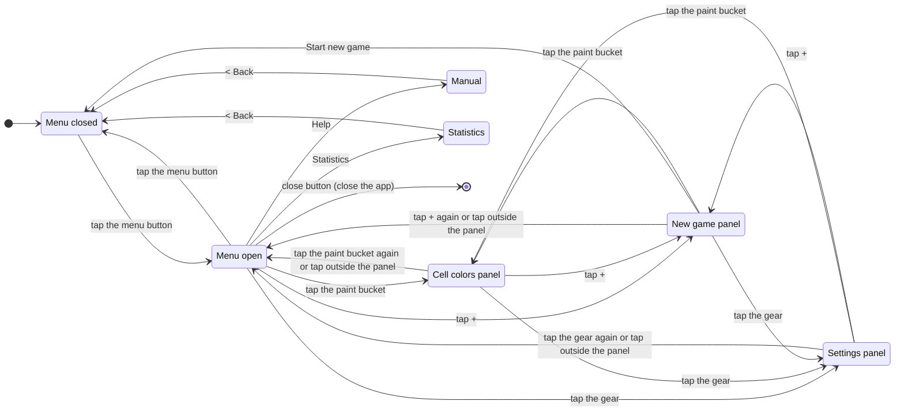

Images: [`screen-toolbar.png`](images/screen-toolbar.png) (menu open, new game, undo and redo gray),
[`screen-completed-menu.png`](images/screen-completed-menu.png) (menu open, complete puzzle, undo
and redo gray), [`manual-menu.png`](images/manual-menu.png).

### 9.1 Settings panel

The gear (top slot 2) opens the Settings panel. The panel has the same design as the Cell colors panel:
it is next to the gear, its top aligns with the button, it is 400 px wide and it has a 2 px border.
It has three rows of 112 px with a 2 px line between them. The first two rows each have a name
(reMarkable Sans Medium, 25 px) and a switch at the right. The third row shows the version of the app.
A stable build (`v<version>`) has a fourth row for updates ([§9.2](#92-updates)).

| Row | Default | When the switch is off |
|---|---|---|
| **Highlight numbers** | On | A tap on a number does not make a highlight ([§6.2](#62-highlights)). |
| **Remove pencil marks automatically** | On | When you add a number, the app does not remove that digit from the pencil marks of the peers ([§6.1](#61-automatic-pencil-mark-removal)). |

- A tap on a row changes its switch immediately. The panel stays open.
- The version row has the name **Version** (reMarkable Sans Medium, 25 px, black) at the left. The
  version is at the right, 33 px from the right edge of the panel (reMarkable Sans Regular, 25 px,
  `gray40`). A release build shows the version of its GitHub release (`pre-<sha>` or `v<version>`,
  with the version of Cargo.toml). All other builds show `dev`. A tap on the version row has no effect, and the panel stays open
  (owner decision 2026-10-26).
- A change of a switch does not change the board and is not a part of undo. It has an effect only on
  the next actions. Changes that are already in the undo history do not change.
- The app keeps the switches when you close the app ([§14.2](#142-settings-kept-when-the-app-closes)).
- A switch that is on is a black track with a white knob at the right. A switch that is off is a white
  track with a black border and a black knob at the left. The track is 72×36 px with a 3 px border, and
  the knob has a diameter of 28 px. The switch ends 33 px from the right edge of the panel.
- While the panel is open, the gear is white on a black square (as the button of each panel).
- The switches are in a panel, and the menu removes the highlight when it opens. Thus a change of a
  switch never changes a highlight that shows. When automatic removal is turned on again, the app does
  not remove marks that are already on the board.
- The Highlighted numbers color stays available in the Cell colors panel when highlights are off.

Image: [`settings-menu.png`](images/settings-menu.png).

### 9.2 Updates

A stable build (version `v<major>.<minor>.<patch>`) looks for a newer stable release on GitHub and
installs it when the user taps a button (owner decision 2026-10-27). A `pre-<sha>` build and a `dev`
build do not look for updates and do not have the update row.

**Look for an update.** The app reads two files of the latest stable release:

- `https://github.com/garbles/sudoku/releases/latest/download/version.json`:
  `{"version": "v<version>", "url": "<archive URL>", "sha256": "<checksum of the archive>"}`.
- `https://github.com/garbles/sudoku/releases/latest/download/version.json.sig`: the ed25519
  signature (64 bytes) of the bytes of `version.json`.

The app has the public key in its program. It uses `version.json` only when the signature is
correct. An update is available only when the version in `version.json` is newer than the version of
the app (compare major, then minor, then patch). A version that is the same or older is not an update.

- The app looks for an update when it opens, and then each 24 hours while it stays open.
- If the app cannot get or examine the two files (for example, Wi-Fi is off), it tries again after
  1 hour. When the Settings panel opens and the last attempt failed, the app tries again immediately.
- The request runs in the background. It never stops the game or the input.
- The app does not keep the result when it closes.

**Caution icon.** When an update is available, the gear has a caution icon at its top right: a red
(`#D62D20`) circle with a radius of 10 px and a white border of 3 px, with a white "!" in it. The
center of the circle is 16 px to the right of and 16 px above the center of the gear. The icon
stays until the app closes (also while the update installs and after it is installed). Image:
[`screen-toolbar-update.png`](images/screen-toolbar-update.png).

**Update row.** The fourth row of the Settings panel has the same height, lines and border as the
other rows. It shows one of these:

| State | Row |
|---|---|
| The first attempt is not complete | "Looking for updates..." |
| The attempts failed, and no attempt was successful | "Cannot look for updates" |
| No update is available | "Sudoku is up to date" |
| An update is available | The button **Update to v\<version\>** |
| The update installs | "Installing update..." |
| The installation failed | "Update failed" for 3 seconds, then the button again |
| The update is installed | "Restart to apply update" |

- The text of a state is reMarkable Sans Regular, 25 px, `gray40`, at the left (33 px from the left
  edge of the panel). The baseline is 65 px below the top of the row.
- The button has a black border of 2 px. It is 33 px from the left and the right edges of the panel,
  and from 22 px to 90 px below the top of the row. It has an update icon at the left: a down arrow
  into a tray (3 px round strokes, approximately 28 px), with its center 40 px from the left edge of
  the button. The text (reMarkable Sans Medium, 25 px, black) starts 72 px from the left edge of the
  button. Images: [`settings-update.png`](images/settings-update.png) and
  [`settings-up-to-date.png`](images/settings-up-to-date.png).
- A tap on the button starts the installation. A tap on the row in a different state has no effect.
  The panel stays open, and the game does not change.
- A later successful attempt changes the row only from "Looking for updates...", "Cannot look for
  updates", "Sudoku is up to date" or the button. A failed attempt does not remove an earlier result.
- "Restart to apply update" is only a text. The user closes the app and opens it again from
  AppLoad. Then the new version operates.

**Installation.** The app runs as root. Thus it installs only an archive that agrees with the signed
`version.json`:

1. The app downloads the archive to `update/` in the data folder ([§14](#14-data-that-the-app-keeps)),
   not to `/tmp`.
2. The SHA-256 checksum of the archive must be equal to `sha256` in `version.json`.
3. The app extracts the archive in `update/`. The archive must have the folder `sudoku/` with the
   program `sudoku` and `external.manifest.json`. It must not have links, or paths that go out of
   the folder.
4. The app moves the new folder next to the AppLoad folder of the app as `sudoku.new`. Then it
   renames the app folder to `sudoku.old` and `sudoku.new` to the app folder. If the second rename
   fails, the app renames `sudoku.old` back. The app never writes over the files of the app that
   operates. The program that operates continues with its old files.
5. The app deletes `sudoku.old` and `update/`. When the app opens, it also deletes a `sudoku.old`,
   a `sudoku.new` and an `update/` that stay from an earlier installation.

If a step fails, the app folder does not change, and the row shows "Update failed".

## 10. Cell colors panel

Image: [`images/color-menu.png`](images/color-menu.png).

- The panel opens next to the paint bucket. The top of the panel aligns with the button. The panel is
  400 px wide and has a 2 px border. The pen-color menu of the device has the same design.
- The panel has three sections. Each section is 448 px high. Lines of 2 px are between the sections.
  The sections are **Starting numbers**, **Clashing numbers** and **Highlighted numbers**.
- Each section has a title (reMarkable Sans Medium, 25 px) and a 3×3 grid of 112 px cells. Each cell
  has a color dot of 38 px and the name of the color below the dot.
- A solid black box with white text shows the selected color.
- The available colors are medium-light, so that the digits are easy to read and the colors are clear on
  the e-ink display: Gray, White, Yellow, Blue,
  Red, Green, Cyan, Magenta and Orange. Black is not available.
- The default colors are: Starting numbers **Gray**, Clashing numbers **Red**, Highlighted numbers
  **Green**.
- **The three sections must use different colors. White is the only exception.** All sections can
  use White.
- If a section uses a color, the other sections show that color as not available. The ring and the
  name are gray, and a line goes through the dot. You cannot select it. White is always available.
- When you tap an available color, the app selects it for that section immediately. The board
  shows the new color immediately. The app keeps the selection when you close the app.

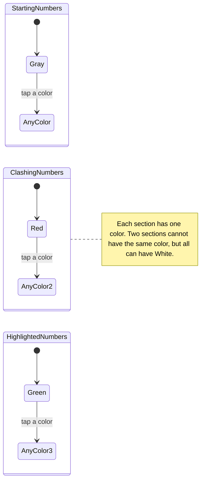

## 11. New game panel and difficulty

Images: [`images/new-game-menu.png`](images/new-game-menu.png),
[`manual-new-game.png`](images/manual-new-game.png).

- The panel opens next to the + button (bottom slot). The + button becomes white on black.
- The panel is 505 px wide. This is wider than the menus of the device, so that the slider is easy to
  use.
- The panel has two rows. The first row has the **difficulty slider** ("Easy", seven stops, "Hard").
  A divider line follows. The second row has **Start new game**, next to the + button.
- The slider has the same size and design as the meter below the board.
- There are **seven modes**, from 0 (Easy) to 6 (Hard). A more difficult mode needs more difficult
  techniques. The puzzle generator sets the techniques of each mode ([§14.5](#145-puzzle-generation)).
- When the panel opens, the slider shows the **last mode that you selected**. At the first start, the
  slider shows **mode 2**.
- When you move the slider, only the selection changes. The game does not change until you tap
  **Start new game**.
- **Start new game** replaces the current puzzle immediately. The app does not ask for a
  confirmation. Then the app:
  - Makes a new puzzle of the selected mode.
  - Closes the menu.
  - Removes the undo and redo history and sets the clock to zero.
  - Keeps the selected mode for the next time.
- The meter below the board always shows the mode of the current puzzle. You cannot change it.

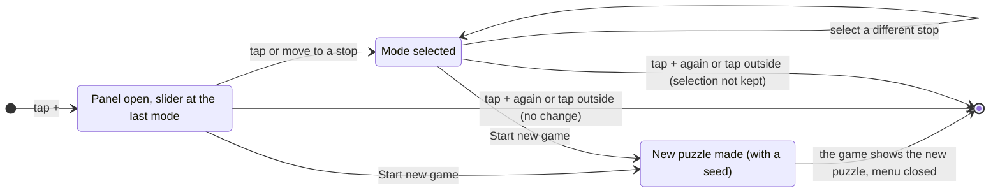

## 12. Manual (Help)

**Help** in the menu opens the manual. The manual has nine pages.

- Each page has **< Back** at the top left. It shows the game again, with the menu closed.
- Each page has ‹ › arrows next to the page number at the bottom. The arrow at the first page and the
  arrow at the last page are gray.
- A **finger swipe** to the left or to the right turns the page. reMarkable notebooks operate in the
  same way.
- The manual always opens at page 1.

| Page | Image | Content |
|---|---|---|
| 1 | [`manual-how-to-play.png`](images/manual-how-to-play.png) | The rules (rows, columns, boxes), starting numbers and your numbers, the close and menu buttons, how to turn the pages. |
| 2 | [`manual-candidates.png`](images/manual-candidates.png) | Micro-cells and pencil marks: how to add and remove them. |
| 3 | [`manual-pen.png`](images/manual-pen.png) | How to write and erase a number. |
| 4 | [`manual-pen-rules.png`](images/manual-pen-rules.png) | Taps, finger touches, one number for each cell, writing with no effect, the "?". |
| 5 | [`manual-helpers.png`](images/manual-helpers.png) | Automatic pencil mark removal and highlights. You can turn each helper off in the Settings panel. |
| 6 | [`manual-mistakes.png`](images/manual-mistakes.png) | Clashes and how to correct them. |
| 7 | [`manual-menu.png`](images/manual-menu.png) | All the menu buttons, how to select colors and the two settings. |
| 8 | [`manual-new-game.png`](images/manual-new-game.png) | How to start a new game, and the meter of the current difficulty. |
| 9 | [`manual-finished.png`](images/manual-finished.png) | Completion, the lock, the clock and the saved results. |

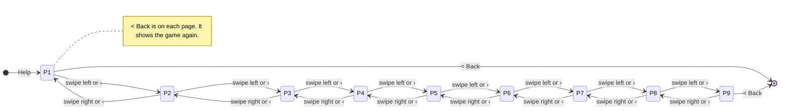

## 13. Statistics

### 13.1 Summary

Image: [`images/analytics.png`](images/analytics.png).

- **< Back** shows the game again, with the menu closed.
- Two boxes show **Puzzles completed** (the quantity of saved results) and **Average time** (the
  average of their times).
- The **By difficulty** table has one row for each mode, from Easy to Hard. Each row shows the
  difficulty meter, the quantity of completed puzzles and the average time. If a mode has no results,
  its average is "–". The rows are 97 units high in portrait and 76 units high in landscape, so that
  the seven rows and the buttons below them fit on the landscape page.
- **All completed games ›** opens the list.
- **Delete all games** is a button with a bin icon at the right of "All completed games ›", in the same
  row (in portrait and in landscape). A tap on it opens a **confirmation dialog** at the center of the
  summary. The summary becomes pale. The dialog has the same design as the delete dialog of the list
  and shows:
  - "Delete all games?"
  - "All N completed games are deleted." (N is the quantity of all saved results, with no filter.
    If N is 1: "1 completed game is deleted.")
  - "You cannot undo this action."
  - **Cancel** and **Delete**. Delete is black.
- **Delete** removes all results from the database and closes the dialog. The summary then shows 0 and
  "–". **Cancel** closes the dialog and makes no change. While the dialog shows, the summary accepts no
  other input. Image: [`analytics-delete-all.png`](images/analytics-delete-all.png).
- If there are no results, "Delete all games" is gray and has no effect.
- If there are no results, the two boxes show 0 and "–", and all rows show 0 and "–".

### 13.2 Completed games list

Image: [`images/analytics-games.png`](images/analytics-games.png).

- **< Back** shows the summary again.
- The **filter** row has **All** and one segment for each mode. Each mode segment shows its meter. The
  meters in the segments are smaller (18 units between the stops, not 34), so that they fit in the
  segments. The selected segment is black. The list opens with All selected.
- The columns are **Date** (date and time of completion, for example "22 Oct 2026, 20:22"),
  **Difficulty** (meter), **Time** (`m:ss` or `h:mm:ss`) and a **bin** button. The newest game is
  first.
- Each page shows **12 games** (6 games in landscape, [§3.3](#33-landscape)). The ‹ › arrows and finger swipes change the page. A change of filter
  shows page 1.
- A tap on a bin opens a **confirmation dialog** on the list. The list becomes pale. The dialog shows:
  - "Delete this game?"
  - The date of the game and its time.
  - "You cannot undo this action."
  - **Cancel** and **Delete**. Delete is black.
- **Delete** removes the result from the database. The list and the summary then show the change.
  **Cancel** closes the dialog and makes no change. Image:
  [`analytics-delete.png`](images/analytics-delete.png).
- If you delete the last game on a page, the list shows the page before it. The page number does not
  go below 1.
- If no results agree with the filter, or if there are no results, the list shows no rows.

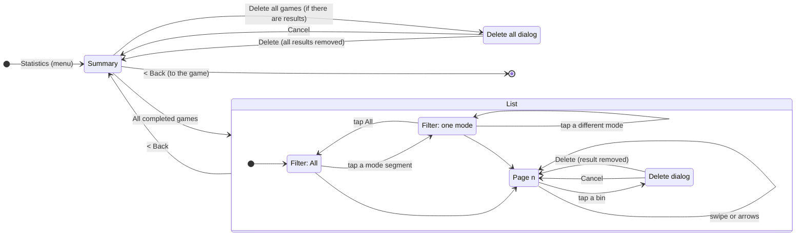

## 14. Data that the app keeps

### 14.1 Results database (SQLite)

The database has one row for each completed puzzle:

| Column | Meaning |
|---|---|
| `id` | Primary key |
| `finished_at` | Date and time of completion |
| `mode` | Difficulty, from 0 (Easy) to 6 (Hard) |
| `givens` | Quantity of starting numbers |
| `seconds` | Time that the player used (clock time, [§8.4](#84-the-clock)) |
| `seed` | Random seed of the puzzle generator. With the seed, the generator can make the same puzzle again. |
| `generator` | The version of the generator that made the puzzle ([§14.5](#145-puzzle-generation)). The seed gives the same puzzle only with the same version. |

The app adds a row when a puzzle is complete. Only the bin in the games list and **Delete all games** on the summary remove rows.

### 14.2 Settings (kept when the app closes)

- The starting-number color, the clash color and the highlight color.
- The last selected difficulty mode (default: mode 2).
- The two switches of the Settings panel: highlight numbers (default: on) and remove pencil marks
  automatically (default: on).

### 14.3 Game in progress (kept when the app closes)

The app saves the current game continuously. When the app opens again, the game is exactly the same.
The app keeps:

- The puzzle, its seed, its mode and the version of the generator.
- All numbers and pencil marks.
- All of the undo and redo history.
- The time on the clock.
- The completion state.

When the app closes, no progress is lost.

The app does **not** keep temporary UI states. The app always opens again at the game screen, with
the menu and the panels closed, no highlight and no "?". If the app closes during the recognition
pause, the app removes the ink and does not read it.

### 14.4 Launcher

The Paper Pro cannot start third-party apps without a launcher. The app uses **AppLoad**
(asivery/rm-appload). AppLoad is the most frequently used launcher on the Paper Pro. AppLoad is a
xovi extension. It operates apps in the reMarkable interface. To install it, use the community
package manager **Vellum**:

1. `vellum add appload`. This installs xovi, xovi-extensions, qt-resource-rebuilder and AppLoad. On
   OS 3.29 the package `launcherctl-appload` does not install, because its dependency
   `lockscreen_hook` supports only OS versions before 3.28.
2. `/home/root/xovi/rebuild_hashtable`, then `/home/root/xovi/start`. After a restart of the tablet,
   run `/home/root/xovi/start` again.
3. Copy the folder `dist/sudoku` (from the Dockerfile) to `/home/root/xovi/exthome/appload/`.

The close button shows the reMarkable interface again. AppLoad draws a black line of 2 px around the
window of each app, also in full screen. The app cannot remove it. The app does not put content at
the outer 2 px of the screen that is necessary to play.

### 14.5 Puzzle generation

A generator with a seed makes each puzzle. Each puzzle must have **only one solution**. The generator
makes the puzzle for the selected mode. Each mode has a most difficult group of techniques (a
level). The puzzle of a mode needs a technique of its level, and no technique of a more difficult
level. No mode needs a guess, and no mode needs a technique that assumes that the puzzle has only one
solution (owner decision, 2026-10-25):

| Mode | Level: the techniques that the mode adds | Starting numbers |
|---|---|---|
| 0 (Easy) | Singles: full house, naked single, hidden single | 44 |
| 1 | Singles | As few as possible |
| 2 | Locked candidates: pointing, claiming | As few as possible |
| 3 | Naked and hidden pairs, triples and quads | As few as possible |
| 4 | X-Wing, Swordfish, XY-Wing | As few as possible |
| 5 | Skyscraper, 2-String Kite, XYZ-Wing, W-Wing, simple colouring, Jellyfish | As few as possible |
| 6 (Hard) | X-Chain, XY-Chain and other alternating inference chains (AIC) | As few as possible |

A human-style solver (`src/solver.rs`) uses these techniques, from the easiest to the most difficult.
For each attempt, the generator:

1. Makes a full, correct grid.
2. Removes starting numbers in a random order. A removal stays only if the solver, with only the
   techniques of the level of the mode, can complete the grid. Thus the puzzle has only one solution.
   Easy stops at 44 starting numbers.
3. Grades the puzzle with all techniques. If the puzzle does not need the level of the mode, the
   generator makes a new attempt (a maximum of 400 attempts).

The generator uses its own random number generator (SplitMix64). Thus a change of a library does not
change the puzzle of a saved seed. The code is in `src/generator.rs`.

**Versions.** A change of the generator gives a different puzzle for the same seed. Thus each game and
each result has the version of the generator. Version 1 (before 2026-10-25) had five modes (0 to 4) and
set only the quantity of starting numbers (44, 37, 31, 27, 24). The app keeps version 1 only to
examine a game that it saved before version 2. A game file with no version is version 1. When the
app opens a results database of version 1, it moves the rows to the new table with generator version
1. A row that the app cannot use stays in the file, in the table `results_v1`.

## 15. Visual specification

| Item | Value |
|---|---|
| Screen | 1620×2160, 229 DPI |
| Board | Cells of 147 px, micro-cells of 49 px, origin (148, 418) |
| Board lines | Box and border 12 px black; cell 3 px black; micro-cell 2 px `gray80` |
| Numbers | reMarkable Sans Regular 104 px; starting numbers black, your numbers `gray35` |
| Pencil marks | reMarkable Sans Regular 31 px, `gray15`, at the center of their micro-cell |
| "?" | reMarkable Sans Regular 104 px, `gray40` |
| Default colors | Starting `#C8C8C8`, clash `#F0A3A3`, highlight `#B5DF9E` |
| UI text | reMarkable Sans Medium 25 px (menus, meter labels, "Completed in …") |
| Toolbar | x 1508–1620, slots of 112 px, icons of approximately 40 px, round strokes of 3 px |
| Panels | 2 px black border, rows of 112 px, 2 px dividers, inner margin of 33 px |
| Close button | Circle of 38 px, 3 px stroke, center (55.5, 55.5) |
| Difficulty meter | "Easy" to "Hard" across 440 px; 7 stops; the current stop is a knob with a radius of 13 px |
| Switch (Settings panel) | Track 72×36 px, 3 px border; knob of 28 px; 33 px from the right edge of the panel |
| Caution icon (gear) | Circle `#D62D20`, radius 10 px, 3 px white border, white "!"; center 16 px right of and 16 px above the gear center |

All dimensions are in [`scripts/ui-lib.sh`](scripts/ui-lib.sh).

## 16. Open questions

1. **Handwriting recognition.** The recognizer (`src/recognizer.rs`) compares the ink with the
   handwriting of 60 writers (UJI Pen Characters; refer to `assets/README.md`). For writers that are
   not in its examples, it reads 97.8 % of the digits correctly, reads 0.8 % as a different digit and
   rejects 91.3 % of the letters and symbols. It also has examples of 4 and 9 with the shapes of the
   typeface, and of 1 as a straight vertical line, in both directions of writing. Characters with the shape of a 1 (for example `l` and
   `I`) are read as 1. On the device, the owner's 4s and 9s in the shape of the typeface (written
   from the bottom up) were not read; the typeface examples correct this (`tests/fixtures/owner-ink.jsonl`).
   If a digit is often read incorrectly for a player, add examples for it.

These items are closed:

- **Recognition pause** (closed 2026-10-25). The owner examined 0.5 s on the device: numbers with two
  strokes stay together, and single digits show quickly.
- **E-ink check** (closed 2026-10-25). The owner examined the faint micro-cell lines, the pale colors
  and the gray icons on the device. All are clear.
- **Puzzle generator** (closed 2026-10-25). Refer to §14.5.

## 17. Image reference

This table gives all the images in [`images/`](images/) and the sections that tell about them:

| Image | Section |
|---|---|
| [`template.png`](images/template.png) | [§1](#1-device-and-display) |
| [`screen.png`](images/screen.png) | [§3](#3-the-game-screen) |
| [`box.png`](images/box.png) | [§3.1](#31-layout) |
| [`cell.png`](images/cell.png) | [§3.1](#31-layout) |
| [`screen-in-progress.png`](images/screen-in-progress.png) | [§3.2](#32-game-screen-states), [§6](#6-helpers-pencil-mark-removal-highlights-clashes) |
| [`screen-highlight.png`](images/screen-highlight.png) | [§6.2](#62-highlights) |
| [`screen-unrecognized.png`](images/screen-unrecognized.png) | [§5](#5-pen-and-touch-input) |
| [`screen-completed.png`](images/screen-completed.png) | [§8.3](#83-complete) |
| [`screen-completed-menu.png`](images/screen-completed-menu.png) | [§8.3](#83-complete), [§9](#9-the-menu) |
| [`screen-toolbar.png`](images/screen-toolbar.png) | [§9](#9-the-menu) |
| [`color-menu.png`](images/color-menu.png) | [§10](#10-cell-colors-panel) |
| [`color-menu-right-handed.png`](images/color-menu-right-handed.png) | [§3.1](#31-layout), [§10](#10-cell-colors-panel) |
| [`new-game-menu.png`](images/new-game-menu.png) | [§11](#11-new-game-panel-and-difficulty) |
| [`analytics.png`](images/analytics.png) | [§13.1](#131-summary) |
| [`analytics-games.png`](images/analytics-games.png) | [§13.2](#132-completed-games-list) |
| [`analytics-delete.png`](images/analytics-delete.png) | [§13.2](#132-completed-games-list) |
| [`manual-how-to-play.png`](images/manual-how-to-play.png) | [§12](#12-manual-help) |
| [`manual-candidates.png`](images/manual-candidates.png) | [§5](#5-pen-and-touch-input), [§12](#12-manual-help) |
| [`manual-pen.png`](images/manual-pen.png) | [§5](#5-pen-and-touch-input), [§12](#12-manual-help) |
| [`manual-pen-rules.png`](images/manual-pen-rules.png) | [§5](#5-pen-and-touch-input), [§12](#12-manual-help) |
| [`manual-helpers.png`](images/manual-helpers.png) | [§6](#6-helpers-pencil-mark-removal-highlights-clashes), [§12](#12-manual-help) |
| [`manual-mistakes.png`](images/manual-mistakes.png) | [§6.3](#63-clashes), [§12](#12-manual-help) |
| [`manual-menu.png`](images/manual-menu.png) | [§9](#9-the-menu), [§12](#12-manual-help) |
| [`manual-new-game.png`](images/manual-new-game.png) | [§11](#11-new-game-panel-and-difficulty), [§12](#12-manual-help) |
| [`manual-finished.png`](images/manual-finished.png) | [§8.3](#83-complete), [§12](#12-manual-help) |
| `manual-*-landscape.png` (9 images) | [§3.3](#33-landscape), [§12](#12-manual-help) |
| [`settings-menu.png`](images/settings-menu.png) | [§9.1](#91-settings-panel) |
| [`settings-update.png`](images/settings-update.png) | [§9.2](#92-updates) |
| [`settings-up-to-date.png`](images/settings-up-to-date.png) | [§9.2](#92-updates) |
| [`screen-toolbar-update.png`](images/screen-toolbar-update.png) | [§9.2](#92-updates) |
| [`analytics-delete-all.png`](images/analytics-delete-all.png) | [§13.1](#131-summary) |
| `analytics-landscape.png`, `analytics-games-landscape.png`, `analytics-delete-landscape.png`, `analytics-delete-all-landscape.png` | [§3.3](#33-landscape), [§13](#13-statistics) |
