# Sudoku for reMarkable Paper Pro — Requirements

This document is written in ASD-STE100 Simplified Technical English (STE).

This document tells what the app does. It gives the screens, all the states, all the inputs and the
results of the inputs, and the data that the app keeps.

The images in [`images/`](images/) show each state exactly. The script
[`scripts/build.sh`](scripts/build.sh) makes the images. The file
[`images/INDEX.md`](images/INDEX.md) gives a list of the images.

If a behavior is not known yet, it is in [Open questions](#16-open-questions). The body of this
document does not include unknown behavior.

## Contents

1. [Device and display](#1-device-and-display)
2. [Screens](#2-screens)
3. [The game screen](#3-the-game-screen)
4. [Cells](#4-cells)
5. [Pen and touch input](#5-pen-and-touch-input)
6. [Helpers: pencil mark hiding, highlights, clashes, completed groups](#6-helpers-pencil-mark-hiding-highlights-clashes-completed-groups)
7. [Undo and redo](#7-undo-and-redo)
8. [Puzzle states and the clock](#8-puzzle-states-and-the-clock)
9. [The menu](#9-the-menu)
10. [Cell colors panel](#10-cell-colors-panel)
11. [New game panel and difficulty](#11-new-game-panel-and-difficulty)
12. [Manual (Help)](#12-manual-help)
13. [Statistics](#13-statistics)
14. [Data that the app keeps](#14-data-that-the-app-keeps)
15. [Visual specification](#15-visual-specification)
16. [Open questions](#16-open-questions)
17. [Image reference](#17-image-reference)

---

## 1. Device and display

- The target device is the **reMarkable Paper Pro**. It has a color e-ink display of 1620×2160 px
  (portrait) at 229 DPI and a 64-bit ARM processor.
- Build the executables in the Linux Dockerfile of the project. Refer to `AGENTS.md`.
- The app operates in portrait and in landscape (2160×1620). When the tablet turns, AppLoad tells the
  app the rotation, and the app shows its landscape layout. Refer to [§3.3](#33-landscape).
- [`images/template.png`](images/template.png) is the blank 1620×2160 frame for all screens.
- The display can show color. All states must be clear if the e-ink display dithers the colors.
- The UI font is **reMarkable Sans**, the font of the device. The app loads the font from the tablet
  when the app starts (`/usr/share/remarkable/webui/reMarkableSans.woff2`). The app does not include a
  copy of the font.

## 2. Screens

The app has six screens. The game screen also has a menu with four panels. Refer to
[§9](#9-the-menu).

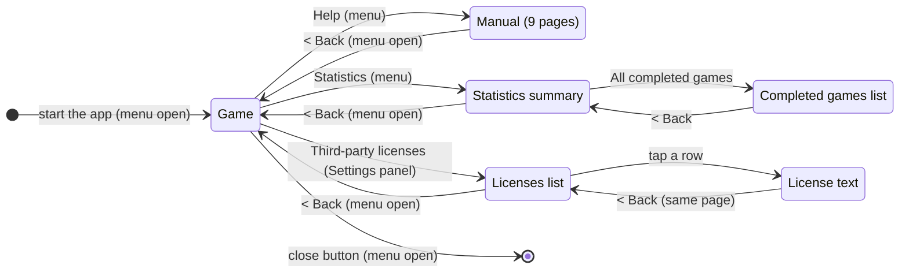

| Screen | Images |
|---|---|
| Game | [`screen.png`](images/screen.png), [`screen-in-progress.png`](images/screen-in-progress.png), [`screen-completed-group.png`](images/screen-completed-group.png), [`screen-completed.png`](images/screen-completed.png) and the menu images in §9 |
| Manual | [`manual-how-to-play.png`](images/manual-how-to-play.png) to [`manual-finished.png`](images/manual-finished.png) (§12) |
| Statistics summary | [`analytics.png`](images/analytics.png), [`analytics-delete-all.png`](images/analytics-delete-all.png) |
| Completed games list | [`analytics-games.png`](images/analytics-games.png), [`analytics-delete.png`](images/analytics-delete.png) |
| Licenses list, License text | [`licenses.png`](images/licenses.png), [`licenses-text.png`](images/licenses-text.png) (§9.4) |

## 3. The game screen

Image: [`images/screen.png`](images/screen.png) (empty board, menu closed). The app opens with the menu
open ([§9](#9-the-menu)): refer to [`screen-toolbar.png`](images/screen-toolbar.png).

### 3.1 Layout

| Item | Position and size | Notes |
|---|---|---|
| Board | 9×9 cells of **147 px**; x 148–1471, y 418–1741 (at the center of the screen) | Lines of 13 px are around the board and the 3×3 boxes. Lines of 3 px are between the cells. |
| Micro-cells | Each cell has a very faint 3×3 grid of **49 px** micro-cells (2 px lines, default `gray90`; the player can select a different gray or no lines, §10). Each line is a dotted pattern of `gray15` and white pixels with the darkness of the selected gray ([§4.1](#41-types-of-cell); owner approval 2026-11-08) | Each micro-cell is for one digit. The positions are the same as a keypad: 1 2 3 / 4 5 6 / 7 8 9. |
| Difficulty meter | Below the board, at the center, 50 px from the board | The player cannot change it. It shows "Easy", seven stops and "Hard". The large knob shows the mode of the current puzzle. When the puzzle is complete, the **result card** replaces the meter ([§8.3](#83-complete); owner approval 2026-11-07). |
| Result card | Only on a complete puzzle: x 148–1471, y 1790–2110 (49 px below the board, 320 px high). The same for a left-handed and a right-handed player | The time, the comparison with the earlier results and the level buttons Easier, Same and Harder ([§8.3](#83-complete)). |
| Menu button | Top right, circle of 38 px, center at (1563.5, 55.5) | Closed icon: dot at the bottom left. Open icon: dot at the top left. Each icon is a ring (radius 18 px, line of 3 px) and a dot (radius 4.5 px), 5.5 px left of the center and 5.5 px below it (closed) or above it (open). |
| Close button | Top left, circle of 38 px with ×, center at (55.5, 55.5) | The close button shows **only when the menu is open**. The device does the same. |

The open menu starts at x 1508. The board ends at x 1471. Thus the open menu does not cover the board
(gap of 37 px).

The positions above are for a **left-handed** player. The app reads the handedness of the device
(`RightHanded` in `[General]` of `/home/root/.config/remarkable/xochitl.conf`) when it starts. For a
**right-handed** player (`RightHanded=true`, or no value), the menu is at the other side:

- The toolbar is at the left edge (x 0–112). The menu button is at the top left, center (55.5, 55.5).
  Its icon is a mirror image (the dot is at the right).
- The close button is at the top right, center (1563.5, 55.5).
- The panels touch the toolbar at its right side (for example, Cell colors at x 112–911 and
  Checkpoints at x 112–711).
- The other icons and the contents of the panels do not change.

The board, the meter, the result card, the manual and the statistics do not change.

Image: [`images/color-menu-right-handed.png`](images/color-menu-right-handed.png) (the Cell colors
panel of `color-menu.png` for a right-handed player).

[`images/box.png`](images/box.png) shows one 3×3 box. [`images/cell.png`](images/cell.png) shows one
cell with its micro-cells. Both images use the scale of the board and have 20 px of space around them.

### 3.2 Game screen states

The game screen has three independent parts:

- The **puzzle state** (§8).
- The **menu state** (§9).
- A **temporary overlay** on the board: a highlight, a "?" or an x in a micro-cell
  ([§6.1](#61-automatic-pencil-mark-hiding)).

Overlays occur only when the puzzle is in progress. A completed puzzle does not show overlays.
A highlight can show while the menu or a panel is open. Only the items in [§6.2](#62-highlights) remove
a highlight. A finger or a hand on the screen does not remove it (owner approval 2026-11-07). A "?" can
show with a highlight in a different cell: a pen tap on a number while ink waits in a different cell reads
the ink at the press and makes the highlight at the lift (approved prototype 2026-11-07).

The "?" and the x can show at the same time in different cells, each with its own time. Example: a
scribble waits in cell A, and the player does a refused tap in cell B. The app reads the ink first,
thus the "?" shows in A, and the x shows in B (owner decision 2026-11-04).

These rules for the x are true at all times (they follow from the owner approval 2026-11-04):

- At most one x shows.
- An x implies all of these: the game screen shows, no panel is open, the game is not complete, its
  cell is empty, "Hide pencil marks automatically" is on, a peer has its digit, no highlight shows
  and no ink waits. The x is never on the same cell as a "?".
- These remove the x: the end of its time, a press of the pen or of a finger (§5.1; not a touch that
  starts less than 150 ms after a pen lift, owner approval 2026-11-07), the release of a control that does an action (§9), completion, a change of screen, a new game and the update
  dialog (§9.2). The release of a control removes only the x, not a "?" in a different cell.

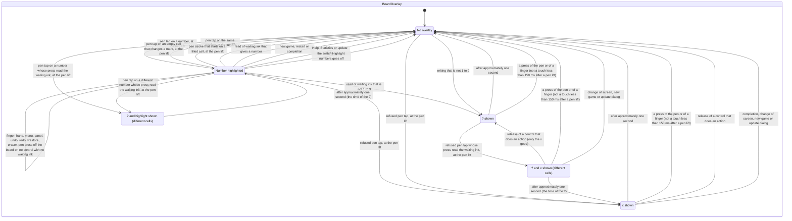

| Overlay | Image |
|---|---|
| No overlay | [`screen-in-progress.png`](images/screen-in-progress.png) |
| Number highlighted | [`screen-highlight.png`](images/screen-highlight.png) |
| "?" shown | [`screen-unrecognized.png`](images/screen-unrecognized.png) |
| x shown | [`screen-invalid-mark.png`](images/screen-invalid-mark.png) |

### 3.3 Landscape

The landscape layout has the same items, at the same sizes, as the portrait layout:

| Item | Landscape position |
|---|---|
| Board | At the center: x 418–1741, y 148–1471. The difficulty meter is 50 px below the board. |
| Result card | A column with the height of the board (y 148–1471), 322 px wide, at the side opposite the toolbar: x 48–370 for a left-handed player (toolbar at the right), x 1790–2112 for a right-handed player (toolbar at the left). Only the column moves: its contents are the same for the two hands (not a mirror image). [§8.3](#83-complete) gives the contents (owner approval 2026-11-07). |
| Menu | The toolbar is at the right edge (x 2048–2160). Bottom slot 0 starts at y 1508; the top slots start at y 0. The panels touch the toolbar, as in portrait. The Cell colors panel is at x 1248–2047, y 112–1192 (right-handed: x 112–911; [§10](#10-cell-colors-panel)). The Checkpoints panel is at x 1448–2047, with its top at y 560 (right-handed: x 112–711; [§9.3](#93-checkpoints-panel)). |
| Close button | Top left, as in portrait. For a right-handed player, the toolbar is at the left edge (x 0–112) and the close button is at the top right (§3.1). |
| Manual | Each page has a landscape version with two columns (`manual-*-landscape.png`, made by `scripts/manual-*-landscape.sh`). The content is the same as in portrait. |
| Statistics | The same scale as in portrait, across the full width. The games list is one table across the full width. Each page shows 6 games, because the height is too small for 12. When the tablet turns, the list shows the page with the first game of the page before the turn. The delete dialog is at the center (`analytics-landscape.png`, `analytics-games-landscape.png`, `analytics-delete-landscape.png`, `analytics-delete-all-landscape.png`, made by `scripts/analytics.py`). |

When the tablet turns, the game does not change. Ink that waits for the recognition pause and touches
in progress are removed, because their positions are not correct after the turn. The "?" and the x
stay on the same cell (and the x on the same digit) for the rest of their time. A pen tap in progress
at the turn makes no x, because the pen gesture stops (this follows from the owner approval
2026-11-04). A highlight stays (owner approval 2026-11-07).

## 4. Cells

### 4.1 Types of cell

Each cell is always one of these four types:

| Type | Appearance | Changes |
|---|---|---|
| **Starting number** | Black digit. No micro-cells. Background: refer to [§4.2](#42-cell-background-color). | It does not change. Writing on it and the eraser have no effect. |
| **Your number** | Dark gray digit. No micro-cells. Background: refer to [§4.2](#42-cell-background-color). The app keeps its pencil marks but does not show them. | Only the eraser, undo, redo or a Restore ([§9.3](#93-checkpoints-panel)) can remove it. Writing on it has no effect. |
| **Empty, no pencil marks** | The very faint 3×3 grid of micro-cells. | Tap to add a pencil mark. Write to add a number. |
| **Empty, with pencil marks** | The grid of micro-cells with small digits in their keypad positions. | Tap to add or remove a pencil mark. Write to add a number. |

If automatic hiding is on, a tap on a micro-cell whose digit is a number in a peer has no effect
([§6.1](#61-automatic-pencil-mark-hiding)). Then the cell does not change, and a small x shows for
approximately one second in that micro-cell (owner approval 2026-11-04).

Digits use reMarkable Sans Regular: 104 px for numbers and 31 px for pencil marks. Starting numbers
are black. Your numbers are dark gray (`#1E1E1E`; owner approval 2026-11-04 and 2026-11-05). The
numbers have anti-aliasing. The pencil marks have no anti-aliasing: each pixel of a mark is `gray15`
or the pixel of the empty cell under it ([§15](#15-visual-specification); owner approval 2026-11-07).

The **micro-cell lines** of an empty cell are a pattern of `gray15` and white pixels with the darkness
of the gray that the Micro-cell lines section selects ([§10](#10-cell-colors-panel); owner approval
2026-11-08, on the tablet). The pattern is an ordered 4×4 Bayer dither with the matrix
`[[0, 8, 2, 10], [12, 4, 14, 6], [3, 11, 1, 9], [15, 7, 13, 5]]`: a pixel is `gray15` when
`matrix × 16 + 8 <= 255 − gray` (the gray as a value from 0, black, to 255, white), else white. The
pattern starts at the origin of each line (the first pixel of the line), thus all lines of the board
have the same density, in all cells and in the two directions. Each line is exactly 2 px wide, on the
pixels of a crisp line: the offset pixel (49 px or 98 px from the cell origin) and the pixel after it,
over the full cell (147 px). No pixel of a line is a gray other than `gray15`, and no pixel has an
intermediate value: each pixel of an empty cell with no marks is white or `gray15`. Orientation of
the matrix (owner decision 2026-11-08): the row index of the matrix is the position along the line
(the pixel index from the origin of the line, modulo 4), and the column index is the position across
the line (0 for the offset pixel, 1 for the pixel after it). Thus a vertical line uses
`matrix[dy mod 4][dx]` and a horizontal line uses `matrix[dx mod 4][dy]`, and the two directions
sample the same 8 entries of the matrix (the columns 0 and 1: 0, 12, 3, 15 and 8, 4, 11, 7). In each
run of 2×4 px of a line, the quantity of `gray15` pixels is the darkness of the gray, the same in the
two directions: `gray90` 1 of 8, `gray80` 1 of 8, `gray70` 3 of 8, `gray60` 3 of 8, `gray55` 3 of 8,
`gray50` 4 of 8, `gray45` 5 of 8, `gray40` 5 of 8 (count the entries m of the 8 with
`m × 16 + 8 <= 255 − gray`). The pattern of a line writes only its `gray15` pixels; the other pixels
keep what is under them (white). Thus at a crossing of a vertical and a horizontal micro-cell line (a
2×2 px square), a pixel is `gray15` when one of the two lines has a `gray15` pixel there (the union of
the two patterns). The disc of a swatch is the same: white first, then the `gray15` pixels of the
pattern ([§10](#10-cell-colors-panel); owner decision 2026-11-08). The setting None gives no lines. The pattern is a function of the position in the
line and of the darkness only: the first frame, a redraw, the snapshot tool, the bench and the videos
give the same pixels. The dots are `gray15` and not black: with black dots, an empty cell was a pure
black and white area, and xochitl selected its mono waveform when a color appeared in the cell (a
written digit that clashes), thus the clash color was washed out. With `gray15` dots the clash color
is correct, and the dots look nearly black on the panel ([§14.4](#144-launcher); owner test
2026-11-08). The board lines (3 px and 13 px, black) have no anti-aliasing (owner approval
2026-11-08, on the tablet). Before, each board line had one faint anti-aliased pixel (value 191 of
255) on its right or bottom side (at offset + 2 for a 3 px line, offset + 7 for a 13 px line), and
the ends of the border had pixels of 143. With the crisp lines these pixels are white: the black
pixels do not change, the faint edge pixels go away.

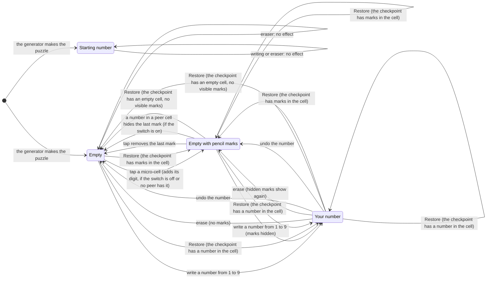

### 4.2 Cell background color

The background of a filled cell is the first rule that applies (owner approval 2026-11-04 and 2026-11-05):

1. **Clash.** The number clashes ([§6.3](#63-clashes)): clash color (default: Red).
2. **Highlight.** The number is the highlighted digit ([§6.2](#62-highlights)): highlight color
   (default: Cyan).
3. **Completed group.** The cell is in a complete group, and the completed color shows
   ([§6.4](#64-completed-groups)): completed color (default: Green).
4. **Starting number:** starting-number color (default: Gray).
5. All other filled cells: white.

Empty cells are white. A cell that shows the "?" has no completed color.

The player selects the four colors in the Cell colors panel ([§10](#10-cell-colors-panel)).

## 5. Pen and touch input

### 5.1 Rules

- **Finger touches on the board change no number and no pencil mark.** Only the reMarkable pen
  operates the board. A finger touch removes the "?" and the x at the press, except for a hand touch
  (below). A finger touch does not remove a highlight ([§6.2](#62-highlights); owner approval 2026-11-07).
- A finger can operate all items that are not on the board: the menu buttons, the panels, the dialogs
  and the screen buttons (for example "< Back"). The pen can also operate these items. The close button
  is the exception: a finger does not close the app ([§9](#9-the-menu); owner approval 2026-11-06).
- In the manual and the games list, a finger swipe turns the page. Refer to [§12](#12-manual-help) and
  [§13](#13-statistics). A swipe is a horizontal finger movement of 120 px or more, with more
  horizontal than vertical movement.
- A **tap** is a pen touch that stays in one micro-cell from start to end. If the pen moves out of the
  micro-cell before it lifts, the touch is writing, not a tap. While ink waits in a cell, each pen
  touch that starts in that cell is writing, also if it stays in one micro-cell. Thus a short stroke
  of a number (for example the bar of a 7) does not become a pencil mark (confirmed 2026-10-25).
- A pen touch that starts on an **empty cell** shows ink from the pen down, also for a tap. The ink is
  a black line of 5 px with round ends and joins; the ink of a tap is a dot with a radius of 2.5 px.
  The ink has **no anti-aliasing**: each pixel of a stroke or of the dot is black or the pixel that
  was under it, also where a stroke crosses a filled cell, also in the corpus build. The pen waveform
  of the ink patch gives crisp pixels a smoother stroke ([§14.4](#144-launcher),
  [§15](#15-visual-specification); owner approval 2026-11-07). A pen touch
  that starts on a **filled cell** shows no ink and starts no pen area ([§14.4](#144-launcher)). This
  includes a tap on a number and a stroke that starts on a number. A stroke that starts on an empty cell
  and crosses a filled cell still shows ink. The corpus build still logs the strokes that do not show
  (owner approval 2026-11-07). The ink of a tap goes away when its mark or its x shows, at the pen
  lift (owner request 2026-11-07). If §6.1 refuses the tap, the x shows at the pen lift, not at the pen
  down (owner approval 2026-11-04).
- **Writing** is a pen stroke that is not a tap. The app collects the strokes in one cell until the
  pen is lifted for the **recognition pause of 1 s**. The pause starts at the pen lift, and a new stroke
  in the same cell stops it. Thus a number with more than one stroke (for example 4, 5 or 7) is correct
  (owner approval 2026-11-07).
- The pause is one fixed value in the source. The AppLoad manifest does not set it, and no environment
  variable changes it. Thus an update gives the new pause at the next start of Sudoku, with no restart
  of xochitl, also when AppLoad keeps an old manifest in memory (owner approval 2026-11-07).
- Time line for one number, in normal use: the app reads the ink at 1 s after the pen lift, the digit
  goes to the screen approximately 45 ms after that, and the display completes it at approximately
  1.45 s. The last value is an estimate from the 400 ms that the app gives a screen update. It is not
  measured on the panel (owner approval 2026-11-07).
- After the pause, the app reads all of the strokes as one item. Neat handwriting is not necessary.
  The app removes the ink and shows the typed number.
- The writing belongs to the cell where the pen touch started. A pen touch that starts in a
  different cell, or a pen press on a control (for example a menu button), makes the app read the
  waiting ink immediately (confirmed 2026-10-25). A pen press off the board on no control also reads
  it, as each pen press does (approved prototype 2026-11-07).
- **A finger press never reads waiting ink and never stops the writing**, also outside the board. A
  control that a finger operates reads waiting ink and stops the writing at its release, on the
  control. A release outside the control does nothing (owner approval 2026-11-07).
- **Hand touches** (owner approval 2026-11-07). The tablet sends a touch from the hand approximately 97 ms after each pen
  lift, and that touch ends a few ms before the next pen down (measured on the tablet, input log,
  2026-11-07). A touch that starts less than 150 ms after a pen lift has no effect at all: it does not
  operate a control, and it does not remove an x or a "?". Its move and its release also have no
  effect. The owner knows this risk: a touch from the hand more than 150 ms after a pen lift, on a
  toolbar button, still operates it.
- **Accuracy target** (confirmed 2026-10-25): for writers that are not in the examples of the
  recognizer, the app reads 96 % or more of the digits correctly and reads 1.2 % or less as a
  different digit. The other digits show the "?". The test `writer_independent_accuracy` examines this
  target. Its limits are 97.5 % or more of the digits correct, 1.2 % or less a different digit, and
  90.0 % or more of the other characters rejected (owner approval 2026-11-06). The test also uses the
  examples of the owner, thus an added example can change its result. This is the reason for the
  margin between the limits and the measured values ([§16](#16-open-questions)).
- **Accuracy for reversed ink** (review of the change, 2026-11-06): the accuracy target also applies
  to fully reversed ink. A test examines this on the writers 41 to 60 of the database. For these
  writers, the ink and its full reversal gave the same result on all 3360 test inks. This is a
  measurement on this set. It is not a rule for all ink. Ink with only the stroke directions or only
  the stroke order reversed, or with only some strokes reversed, is not in the target
  ([§16](#16-open-questions)). The owner knows this and approved the change (2026-11-06).
- **Pen directions of the examples** (owner approval 2026-11-06): each example of the recognizer is
  stored in two pen directions: as written, and fully reversed. Fully reversed means that the last
  stroke is first, and each stroke goes from its end to its start.
  - This applies to all classes: the digits and "not 1-9" (0, letters, symbols).
  - This applies to all sources: the database of 60 writers, the typeface shapes and the handwriting
    of the owner.
  - This applies to each copy of a digit example (each slant, rotation and width copy). Thus one
    sample gives 2 stored examples for "not 1-9" and 18 stored examples for a digit.
  - An example in only one direction must not occur. A shape must not be stored in the same direction
    two times, because duplicates can give one shape more of the 3 votes. Thus the typeface shapes
    are not reversed separately.
- **The ink of the player is not reversed** (owner approval 2026-11-06). The app calculates its
  features one time, as written, and compares them with all stored examples. The reading continues to
  start at the pen lift.
- **Features of the examples** (owner approval 2026-11-06): the app calculates all the example features
  one time at each start, in the background, and keeps them in memory. It does not keep them on disk.
  A reading that comes before the end of this calculation waits for it (review of the change,
  2026-11-06). The acceptance factor of the recognizer stays 1.4 (owner approval 2026-11-06).
- If the writing is **not a number from 1 to 9**, the app shows a gray **?** in the cell for
  **approximately one second**. Examples are a scribble, a letter, 0 or a number more than 9, such as
  12. After the "?", the cell is the same as before.
- Each press of the pen or of a finger removes the "?" immediately. Thus a new number in that cell
  never shows under the "?" (owner decision 2026-10-25). The same press also removes the x, before
  the app does the action of that press. A second finger also removes them (owner approval
  2026-11-04). Exception: a first press that the app ignores in the 0.5 s after **< Back**
  ([§9](#9-the-menu), NAV-16) does not remove the "?" or the x (this follows from the owner approval
  2026-11-04). A touch that starts less than 150 ms after a pen lift also does not remove them
  (owner approval 2026-11-07).
- Only a pen tap that §6.1 refuses makes an x. A finger, the eraser and writing never make an x. A
  short touch in the cell of ink that waits is writing, thus it makes no x (owner approval
  2026-11-04).
- A press removes the state of the x or of the "?" immediately, but their pixels go only when the
  redraw occurs. While the player writes, a redraw waits ([§14.4](#144-launcher)). Thus the pixels of
  the x or of the "?" can stay on the screen, under the ink of the player, until the writing stops:
  approximately one second after the last stroke (owner decision 2026-11-04).
- Writing on a **starting number** or on **your number** changes no number and no mark, and it shows
  no ink. It only removes a highlight ([§6.2](#62-highlights); owner approval 2026-11-07). To change your number, erase it
  first.
- The **eraser** is the other end of the pen. When you rub it on your number, the app removes the
  number. The micro-cells and the pencil marks of that cell show again.
- The eraser has no effect on other cells. It does not change starting numbers. It does not change
  empty cells. Only a tap (or a Restore, §9.3) removes a pencil mark. A number only hides the marks of its peers (§6.1).
- The eraser on the cell of ink that waits for the recognition pause removes that ink. The app does
  not read it, thus the board and the undo history do not change (owner decision 2026-11-02). A
  highlight stays (owner approval 2026-11-07).
- A **Restore** in the Checkpoints panel ([§9.3](#93-checkpoints-panel)) replaces all numbers and all
  marks, also your numbers, without the pen on the board (owner approval 2026-11-06).
- Pen input on the board of a completed puzzle has no effect
  ([§8](#8-puzzle-states-and-the-clock)).

Images: [`manual-candidates.png`](images/manual-candidates.png),
[`manual-pen.png`](images/manual-pen.png), [`manual-pen-rules.png`](images/manual-pen-rules.png),
[`screen-unrecognized.png`](images/screen-unrecognized.png),
[`screen-invalid-mark.png`](images/screen-invalid-mark.png).

### 5.2 Input decisions

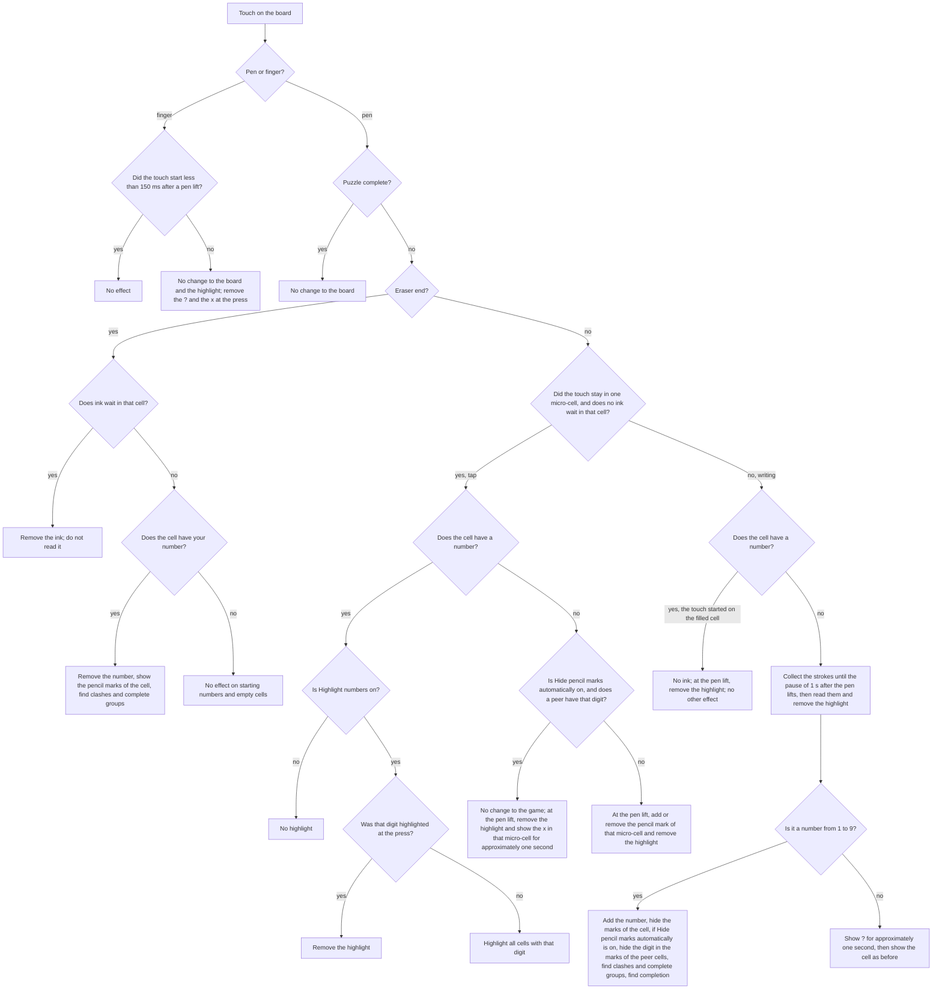

The highlight does not change at the pen press. Its removal or move goes to the screen in one redraw
with the result of the action: a tap at the pen lift, and writing when the app reads the ink. Two updates
remain in these known cases, which the owner accepts: a pen press on a control while ink waits (the
number at the press, the action at the release), and a press on a control that removes an x or a "?"
(the removal at the press, the action at the release) (owner approval 2026-11-07). A pen tap on a number
while ink waits in a different cell is not a third case: the pen touch keeps the writing state until the
lift, thus the redraw waits, and the read and the highlight go in one redraw (approved prototype 2026-11-07).
This applies when the pen area is in use. When the ink patch is not active, redraws do not wait for the
writing, thus this tap gives two updates: the read at the press and the highlight at the lift (review of the change, 2026-11-07). A tap on a number
compares with the highlight as it was at the press, before the read of waiting ink: refer to
[§6.2](#62-highlights) (approved prototype 2026-11-07). Each press also removes the "?" and the x
before the app does the action of that press, with the exceptions in [§5.1](#51-rules).

## 6. Helpers: pencil mark hiding, highlights, clashes, completed groups

### 6.1 Automatic pencil mark hiding

A pencil mark does not show while a cell in the same row, column or 3×3 box has the same digit as a
number (a starting number or your number). The app does not remove the mark: it keeps it. When the
number goes (the eraser, undo, redo or a Restore, [§9.3](#93-checkpoints-panel)), the mark shows again (owner decision 2026-10-31). Image:
[`manual-helpers.png`](images/manual-helpers.png) (top).

- A number does not change the pencil marks of other cells. It only hides them. Thus, the change of a
  number in the undo history has no pencil marks.
- A **tap on a micro-cell whose digit is a number in a peer** has no effect. The mark would be hidden,
  thus the app does not add it, and it does not remove a hidden mark (owner decision 2026-10-31).
  This is a **refused tap**: it changes nothing in the game, and a small x shows in that micro-cell
  (owner approval 2026-11-04; the rules are below).
- The player can turn automatic hiding off in the Settings panel ([§9.1](#91-settings-panel)). Then
  all pencil marks of the empty cells show, and a tap on each micro-cell adds or removes its mark. No
  x shows (owner decision 2026-11-04). When the player turns it on again, the marks of the digits of
  peers are hidden again.
- A Restore replaces the marks with the marks of the checkpoint, also the hidden marks (owner approval
  2026-11-06; [§9.3](#93-checkpoints-panel)).
- A game that was saved by an earlier version can have numbers in its undo history that removed
  marks. Undo and redo of these numbers still put back and remove those marks.

**The x of a refused tap** (owner approval 2026-11-04, on the tablet). This is true in all layouts:
portrait, landscape, left-handed and right-handed. Image:
[`screen-invalid-mark.png`](images/screen-invalid-mark.png).

- **When it shows.** The x shows at the pen lift of a refused tap on an empty cell. A tap on a hidden
  mark that exists is also a refused tap: the cell has the mark d, a peer has the number d and the
  player taps d. The tap has no effect, and the x shows (owner decision 2026-11-04).
- **Time.** The x shows for the same time as the "?": approximately one second. The two use one
  value. The main loop wakes at the end of this time, thus the x goes without other input.
- **Position.** The x is only in its micro-cell. The other visible pencil marks and the micro-cell
  grid of the cell stay visible and do not change. This is different from the "?", which hides the
  marks of its cell. With the micro-cell lines set to None, the x shows with no grid. After the x, the
  pixels of the cell are the same as before the x. [§15](#15-visual-specification) gives the sizes.
- **Pixels.** The x has no anti-aliasing: each pixel that the x changes is `gray15`, the same as the
  pencil marks. Its geometry does not change (owner approval 2026-11-07).
- **Repeated taps.** A new refused tap removes the x at the press and shows it again at the lift. The
  time starts again. At most one x shows.
- **No effect on the game.** The x does not change the numbers, the marks, the undo or redo history,
  the clock or the completion. It does not cause a save.
- **Source of the x.** The x comes only from the numbers in the peers, not from the solution. A peer
  with an incorrect number of the player also causes an x.
- **No x.** A tap on a filled cell, on a completed game, or on the board while a panel is open makes
  no x. [§5.1](#51-rules) gives the inputs that do not make an x.
- **Removal.** [§3.2](#32-game-screen-states) gives the actions that remove the x.

### 6.2 Highlights

Tap a number with the pen (a starting number or your number). The app then gives the highlight color
(default: Cyan) to all cells with that digit. A cell that clashes keeps the clash color. A cell of a
complete group that has that digit shows the highlight color, not the completed color
([§4.2](#42-cell-background-color); owner approval 2026-11-04 and 2026-11-05).

**Only these remove a highlight** (owner approval 2026-11-07):

- A pen tap on the same number (it toggles), or a tap on a different number (it moves), at the pen lift.
- A pen tap on an empty cell, at the pen lift, in the same redraw as the mark or the x.
- A pen stroke that starts on a filled cell, at the pen lift. The redraw can wait up to the 1 s idle time
  ([§14.4](#144-launcher)).
- A read of waiting ink, by any cause, in the same redraw as the number or the "?".
- A new game, a restart of the app (the app does not save the highlight, approved prototype 2026-11-07) and a completed puzzle. A completed puzzle does not show highlights.
- Leaving the board for Help or Statistics. The highlight does not come back on return.
- The update dialog ([§9.2](#92-updates)). The highlight does not come back after **Later**.
- Turning off the switch "Highlight numbers" ([§9.1](#91-settings-panel)). The highlight goes in that
  redraw. While the switch is off, a tap on a number does not make a highlight.

**These do not remove a highlight** (owner approval 2026-11-07):

- A finger or a hand on the board or anywhere else, and a second finger.
- The menu, the panels and their options. A highlight can show while the menu or a panel is open.
- Undo, Redo and Restore. If they remove the last number with that digit, the highlight stays, and it
  shows again when that digit comes back. A tap on that digit then removes the highlight.
- The eraser.
- A pen press off the board on no control, if no ink waits (approved prototype 2026-11-07).

Consequences (owner approval 2026-11-07):

- A pen press on a control while ink waits reads the ink, and that read removes the highlight.
- A pen press off the board on no control while ink waits reads the ink, and that read removes the
  highlight (approved prototype 2026-11-07).
- A pen tap on a number while ink waits in a different cell reads the ink at the press and makes the
  highlight at the lift, in one redraw when the pen area is in use. When the ink patch is not active, the
  tap gives two updates ([§5.2](#52-input-decisions); review of the change, 2026-11-07). A "?" of that read can show with that highlight (approved prototype 2026-11-07).
- A tap on a number compares with the highlight as it was at the press, not with the highlight after
  the read. With highlight v and ink waiting in a different cell, a tap on v reads the ink at the press
  and gives no highlight at the lift. A tap on a different digit w gives highlight w (approved prototype 2026-11-07).
- A control that a finger operates reads waiting ink at its release, and that read removes the highlight.
- The eraser on waiting ink in its own cell, a turn of the tablet and a suspension remove the ink but keep
  the highlight.

A highlight occurs only on the game screen. The redraw rules are in [§5.2](#52-input-decisions).

A stroke on a filled cell removes the highlight in the state, but its pixels can stay up to 1 s. A tap on
that number in this time makes a highlight. The player can see this as a failed removal. The owner did not
ask for a change (review of the change, 2026-11-07).

Images: [`screen-highlight.png`](images/screen-highlight.png),
[`manual-helpers.png`](images/manual-helpers.png) (bottom).

### 6.3 Clashes

Two numbers **clash** when the same digit is two times in a row, column or 3×3 box. All numbers in a
clash get the clash color (default: red). This applies to the two numbers of a pair, starting
numbers and your numbers.

- The app finds the clashes again after each new number, erasure, undo, redo and Restore
  ([§9.3](#93-checkpoints-panel)).
- When there is no clash, the app removes the clash color.
- The app does not compare your numbers with the solution. The clash color and the completed color
  ([§6.4](#64-completed-groups)) come only from the current numbers. Thus a number can be incorrect
  and not in the clash color, and a group with an incorrect number can have the completed color
  (owner approval 2026-11-04 and 2026-11-05).

Images: [`screen-in-progress.png`](images/screen-in-progress.png) (two 9s in column 2),
[`manual-mistakes.png`](images/manual-mistakes.png).

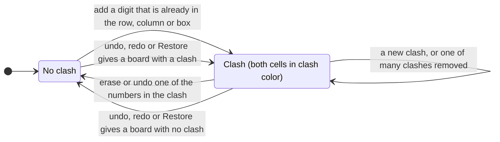

### 6.4 Completed groups

This section has the owner approval 2026-11-04 and 2026-11-05, on the tablet. Image:
[`screen-completed-group.png`](images/screen-completed-group.png).

A **group** is a row, a column or a 3×3 box. A group is **complete** when all nine cells have a number
and none of its cells clashes. All nine cells of a complete group get the **completed color** (default:
Green). [§4.2](#42-cell-background-color) gives the order of the colors.

- **"No errors" means "no clash".** The app does not compare numbers with the solution. Thus a group
  with an incorrect number and no clash is complete. The color does not tell the player that a number
  is correct or incorrect.
- **A clash outside the group.** A cell of the group that clashes with a cell outside the group also
  stops the group: that group is not complete.
- **When the color shows.** The color shows only when all of these are true: the switch "Color
  completed groups" is on ([§9.1](#91-settings-panel)), the selected completed color is not White
  ([§10](#10-cell-colors-panel)), and the game is not complete.
- **White.** White in the Completed groups section means "no completed color". Then a starting number
  keeps its starting color. The result is the same as the switch off.
- **Completed game.** A completed game shows no completed color. At the moment of completion, the
  groups lose the color, and the board shows the normal colors: the starting color for starting
  numbers and white for your numbers. A saved completed game that opens also shows the normal colors.
- **A full group at the start.** A group with only starting numbers that is full at the start of a
  game gets the color from the first frame. There is no exception for it. (Measured: 19 of 300 Easy
  puzzles; no puzzle in the other modes.)
- **Source of the color.** The color comes only from the current numbers. It is not a separate state,
  and the app does not save it. It follows each change: a new number, an erasure, undo, redo, a Restore
  ([§9.3](#93-checkpoints-panel)) and a new game. One input can change cells far from the changed cell: an erasure can remove a clash, and then
  a different group of the other clashing cell becomes complete.
- **No effect on the game.** A group that gets or loses the color adds nothing to the undo and redo
  history. It does not change the clock, the results or the completion state.

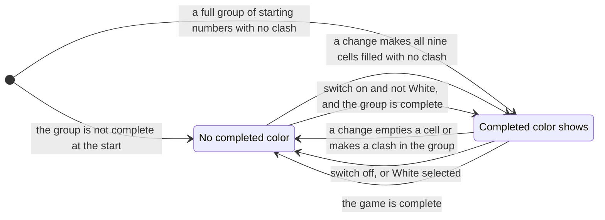

## 7. Undo and redo

- **Undo** cancels the last change to the board. **Redo** makes the last canceled change again.
- These changes are a part of undo:
  - Add or remove a pencil mark.
  - Add a number. (A number does not change the pencil marks of other cells: it only hides them.
    Exception: a number in the undo history of a game that an earlier version saved can have a
    `removed` list; undo and redo of it put back and remove those marks
    ([§6.1](#61-automatic-pencil-mark-hiding)).)
  - Erase a number.
  - Restore a checkpoint ([§9.3](#93-checkpoints-panel)). This is one change, also when it changes many
    cells. Undo returns the board as it was before the Restore, and redo applies the Restore again,
    also after the delete of the checkpoint. In the diagram below, it is a change to the board (owner
    approval 2026-11-06).
- These actions are not changes to the board and are not a part of undo: highlights, the "?",
  the x and the refused tap that makes it (§6.1), a group that gets or loses the completed color
  (§6.4), color changes, switch changes, the panels and screens that you open, and the save and the
  delete of a checkpoint (§9.3; owner approval 2026-11-06). Thus these do not remove the redo history. A
  tap on **Current** has no effect, and it also does not remove the redo history.
- Undo, redo and a Restore do not remove a highlight ([§6.2](#62-highlights); owner approval 2026-11-07).
- A new change after an undo removes the redo history. A refused tap is not a change, thus it does
  not remove the redo history (owner approval 2026-11-04).
- A new game removes the undo history, the redo history and all checkpoints (owner approval 2026-11-06).
- The buttons are **black** when an undo or redo is available. They are **gray** when it is not
  available. Gray buttons have no effect. On a completed puzzle, both buttons are gray and have no
  effect.

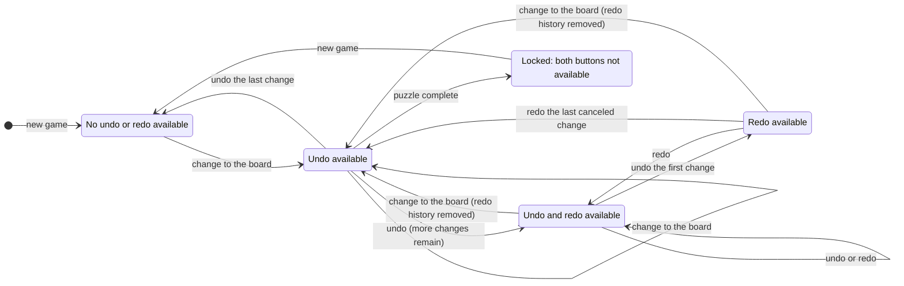

## 8. Puzzle states and the clock

### 8.1 States

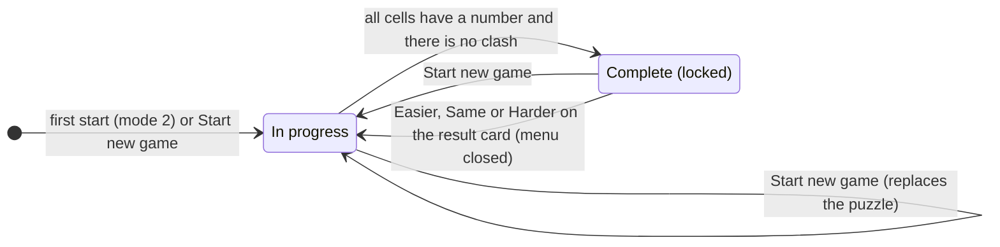

### 8.2 In progress

Images: [`screen.png`](images/screen.png) (a new puzzle, shown empty to show the layout),
[`screen-in-progress.png`](images/screen-in-progress.png).

### 8.3 Complete

A puzzle is **complete** when all cells have a number and there is no clash. Then:

- The **result card** replaces the difficulty meter (owner approval 2026-11-07; it replaces the
  earlier text "Completed in m:ss"). Refer to [The result card](#the-result-card) below.
- The board **locks**. Writing, the eraser, pencil marks, highlights, undo and redo have no effect.
  The undo and redo buttons are gray.
- The board shows no completed color. The groups lose the color at this moment, and the board shows
  the normal colors: the starting color for starting numbers and white for your numbers
  ([§6.4](#64-completed-groups); owner approval 2026-11-04 and 2026-11-05).
- The app saves the result in the database ([§14](#14-data-that-the-app-keeps)).
- **+** and **Start new game** continue to operate. The menu, Help, Statistics, Cell colors and the
  Settings panel continue to operate. The level buttons of the result card also start a new game.
- The Checkpoints panel is not available. The bookmark is `gray70`, a tap on it has no effect, and the
  panel cannot be open. The checkpoints stay in the saved game until a new game
  ([§9.3](#93-checkpoints-panel); owner decision 2026-11-06).

Images: [`screen-completed.png`](images/screen-completed.png),
[`screen-completed-menu.png`](images/screen-completed-menu.png),
[`screen-completed-landscape.png`](images/screen-completed-landscape.png) (left-handed),
[`screen-completed-landscape-right-handed.png`](images/screen-completed-landscape-right-handed.png),
[`manual-finished.png`](images/manual-finished.png).

#### The result card

All rules of this part: owner approval of the prototype `dev/result-card` on the tablet, 2026-11-07,
unless a different source is given.

- The result card shows **only** when the puzzle is complete and the game screen shows. It never
  shows on a game that is not complete. The meter and the card never show at the same time.
- The time has the format of the clock: `m:ss`, and `h:mm:ss` after one hour.
- The card has a 2 px black frame and is white inside.

**Portrait** (1620×2160). The card is the same for a left-handed and a right-handed player.

| Item | Position and size | Content |
|---|---|---|
| Frame | x 148–1471 (the board width), y 1790–2110 (y0 = 1790, y1 = 2110) | 2 px black, white inside |
| "Completed in" | x 188 (x0 + 40), baseline y 1856 (y0 + 66) | reMarkable Sans Regular 30 px, `gray25` |
| Time | x 188, baseline y 1970 (y0 + 180) | Medium 96 px, black |
| Difficulty slider | x 188–628 (440 px), center line y 2022 (y0 + 232) | The mode of the puzzle, with the labels "Easy" and "Hard". The same drawing as the meter below the board. |
| Comparison line | x 188, baseline y 2083 (y0 + 293) | Regular 25 px, `gray25`: "Average m:ss  ·  Previous best m:ss" (two spaces at each side of the middle dot), or "First game at this level" |
| Divider | x 788 (x0 + 640), 2 px wide, from y0 + 24 to y1 − 24 | `gray70` |
| "New game" | x 820 (the divider + 32), baseline y0 + 55 | Medium 28 px, black |
| Level buttons | x 820–1439 (x1 − 32). From the top: **Easier** y 1865–1935, **Same** y 1945–2015, **Harder** y 2025–2095 (70 px high, pitch 80 px, the first at y0 + 75) | 2 px black frame, white inside (no black fill). Label: Medium 30 px, black, at x + 28, baseline at the vertical center + 11. At the right: a small meter of the mode that the button starts (no labels, the meter of the statistics tables, stop step 30 px); its last stop is 40 px from the right frame. |

**Landscape** (2160×1620). The card is a column, x0 to x1, y0 = 148 to y1 = 1471 (the height of the
board), 322 px wide, at the side opposite the toolbar ([§3.3](#33-landscape)). The text starts at
x0 + 28.

| Item | Position and size | Content |
|---|---|---|
| "Completed in" | Baseline y0 + 70 | Regular 30 px, `gray25` |
| Time | Baseline y0 + 185 | **Medium 72 px**, black, at all times (owner decision 2026-11-07: a time of one hour or more must fit in the column) |
| Difficulty meter | At the center of the column, y0 + 255 | The mode of the puzzle, no labels, stop step 40 px |
| Comparison | Labels at baseline y0 + 370 and y0 + 480; values at baseline y0 + 418 and y0 + 528 | Label Regular 25 px `gray25`, value Medium 40 px black: "Average at this level" / m:ss, then "Previous best" / m:ss (110 px lower). With no earlier result: only "First game at this level" (Regular 25 px, `gray25`, baseline y0 + 370). |
| Divider | 2 px, `gray70`, from x0 + 28 to x1 − 28, at y1 − 560 (y 911) | |
| "New game" | Baseline at the divider + 60 | Medium 28 px, black |
| Level buttons | x0 + 20 to x1 − 20. **Easier**, **Same**, **Harder** from the top, each 120 px high, pitch 140 px, the first at the divider + 90 | 2 px black frame, white inside. Label: Medium 32 px, black, centered, baseline at the button top + 50. Below it: a small meter (no labels, stop step 36 px), centered, at the button top + 88. |

**The values of the comparison.**

- The comparison uses the saved results ([§14.1](#141-results-database-sqlite)) of the **same mode**
  as the completed puzzle. It does not use the result of the current game (the result with the same
  seed).
- **Average** is the average of these results, with the same rounding as Statistics
  ([§13.1](#131-summary)). **Previous best** is the shortest time of these results.
- If there are no such results, the card shows "First game at this level".
- The values follow the database. After a delete in Statistics, the card shows the new values when
  the game shows again.

**The level buttons.**

- **Easier** starts a new game at the mode − 1, **Same** at the same mode, and **Harder** at the
  mode + 1 (modes 0 to 6, [§11](#11-new-game-panel-and-difficulty)). The three buttons are equal:
  Same has no highlight (owner request 2026-11-07).
- **One tap starts the game immediately**: a press and a release on the same button. There is no
  confirmation. The pen tip, the eraser and a finger operate the buttons, as the other controls of the
  app (owner decision 2026-11-07). A release on a different position does nothing.
- The new game is the same as after **Start new game** ([§11](#11-new-game-panel-and-difficulty)):
  the last mode and the slider get the new mode, the clock starts and the checkpoints are removed.
  The difference: after a level button, **the menu is closed** and no panel is open.
- The new game of a level button has the **symmetry of the completed game**
  ([§14.5](#145-puzzle-generation)). This symmetry also becomes the saved setting, the same as the
  mode. The card has no switch and shows no symmetry information (owner approval 2026-11-07).
- **Not available:** Easier after an Easy game (mode 0) and Harder after a Hard game (mode 6). Such a
  button has a `gray80` frame, a `gray70` label and no meter. A tap on it has no effect.
- While the card shows, the app makes the puzzle of **Same** in the background, with the next seed
  (only Same; owner decision 2026-11-07) and the symmetry of the completed game (owner approval
  2026-11-07). It starts **immediately at the completion**: also at a
  completion by the reading of the ink at the end of the pause, and when a completed game opens from
  the save. It does not wait for the next input. Easier and Harder use the same next seed with their
  own mode and the same symmetry, and the app makes their puzzle at the tap. The puzzle is the same as a puzzle that the app
  makes at the time of need ([§14.5](#145-puzzle-generation); review finding 2026-11-07).

**Panels, the menu and the layouts.**

- The menu and the panels continue to operate on a completed game. An open panel can cover a part of
  the card. Example: in portrait, the New game panel (three rows, [§11](#11-new-game-panel-and-difficulty))
  covers the three level buttons (Easier, Same and Harder) for a left-handed player, and the left half
  of the card for a right-handed player. The owner accepted this (owner decision 2026-11-07; before
  the Symmetrical row, the panel covered only Same and Harder). When a panel is open, a tap outside
  the panel only closes the panel, also on the card ([§9](#9-the-menu)).
- With the menu closed, the card never touches the toolbar, the close button, the menu button or the
  board, in the four layouts (portrait and landscape, left and right hand). In landscape with the menu
  open, the toolbar and the column are at opposite sides (owner selection 2026-11-07).

### 8.4 The clock

The clock measures the time that the player uses for the current puzzle. The app does not show the
current clock during the game. Each row of the Checkpoints panel shows the clock at the time of its
save ([§9.3](#93-checkpoints-panel); owner approval 2026-11-06). A save, a Restore and a delete of a
checkpoint do not change the clock.

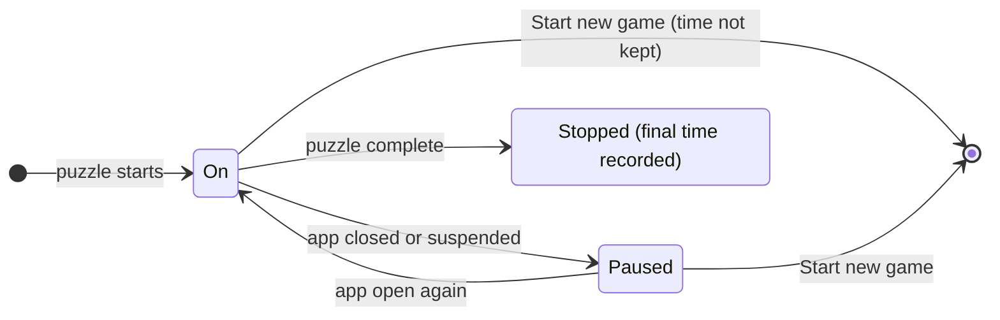

The clock operates only when the app is open. This includes the time when the manual or the statistics
screens are open.

## 9. The menu

The menu is a toolbar of the reMarkable type. It is a column of 112 px at the right edge (x 1508–1620).
For a right-handed player, it is at the left edge (x 0–112) and the close button is at the top right
([§3.1](#31-layout)).
Each button has a slot of 112 px. The icons are 40 px line icons with 3 px strokes.

| Slot | Button | Icon | Action |
|---|---|---|---|
| top 0 | Menu | Circle with a dot (bottom left: closed, top left: open) | Opens and closes the menu. |
| top 1 | Cell colors | Paint bucket | Opens the Cell colors panel ([§10](#10-cell-colors-panel)). |
| top 2 | Settings | Gear | Opens the Settings panel ([§9.1](#91-settings-panel)). |
| top 3 | Undo | Arrow that turns to the left | [§7](#7-undo-and-redo) |
| top 4 | Redo | Arrow that turns to the right | [§7](#7-undo-and-redo) |
| top 5 | Checkpoints | Bookmark | Opens the Checkpoints panel ([§9.3](#93-checkpoints-panel)). Not available on a complete puzzle (owner approval 2026-11-06). |
| bottom 2 | Help | ? in a circle | Opens the manual ([§12](#12-manual-help)). |
| bottom 1 | Statistics | Line graph on axes | Opens the statistics ([§13](#13-statistics)). |
| bottom 0 | New game | + | Opens the New game panel ([§11](#11-new-game-panel-and-difficulty)). |

- The menu is **open by default**. When the game screen shows, the menu is open and no panel is
  open: when the app opens (a new game or a saved game), after **< Back** from the manual or from
  the statistics, and after **Start new game**. The app does not keep the menu state ([§14.3](#143-game-in-progress-kept-when-the-app-closes)).
  Exception: after a level button of the result card (**Easier**, **Same**, **Harder**), the new game
  shows with the menu closed and no panel open ([§8.3](#83-complete); owner approval 2026-11-07).
  On the other screens (manual, statistics, completed games list), the menu is closed.
- After **< Back** from the manual or from the statistics shows the game screen, the app ignores a
  press on the toolbar (all toolbar buttons, also the menu button) and on the close button for
  **0.5 s**. A press on the board operates as usual. This is true for the left-handed and the
  right-handed layout. Reason: the e-paper screen is slow, and **< Back** is at the same position as
  the close button (left-handed) or the menu button (right-handed). Without this rule, the second tap
  of a fast double tap on **< Back** closes the app or closes the menu. A first press that the app
  ignores in this time does not remove the "?" or the x (this follows from the owner approval
  2026-11-04). A second finger on a toolbar button in this time does not operate the button, but it
  removes them, as at all other times (owner decision 2026-11-05).
- The menu and the panels do not remove the highlight. It can show while the menu or a panel is open
  ([§6.2](#62-highlights); owner approval 2026-11-07).
- The board continues to operate while the menu is open. For example, you can write a number or
  tap a number to make a highlight. With the menu open and no panel, a refused tap shows the x
  ([§6.1](#61-automatic-pencil-mark-hiding); owner approval 2026-11-04).
- When a panel is open, a tap outside the panel only closes the panel. The tap has no other effect,
  also when it is on the board. Thus it makes no x. Exception: on a complete puzzle, a tap on the gray
  bookmark changes nothing, and the open panel stays open ([§9.3](#93-checkpoints-panel); approved
  prototype 2026-11-06).
- A finger can stay on a control while the pen does a refused tap. When that finger lifts, the release
  of a control that does an action removes the x. Thus an open panel
  never shows an x, an undo that removes the peer number never leaves an x, and a mark never shows
  under an x. The release removes only the x, not a "?" in a different cell (this follows from the
  owner approval 2026-11-04).
- When the menu is open, the **close button** shows at the top left (at the top right for a
  right-handed player, [§3.1](#31-layout)). When no panel is open, a tap of the pen or of its eraser
  end on it closes the app. The app then shows the launcher ([§14.4](#144-launcher)). A finger press on
  it does not operate it: the press only removes the "?" and the x, as each press does, and the app
  stays open. Reason: a hand on the screen must not close the app (owner approval 2026-11-06). When a
  panel is open, a tap of the pen or of a finger on it only closes the panel (owner decision 2026-11-02).
- When a panel is open, its button is white on a black square. The panel touches the button. The
  pop-up menus of the device do the same.
- A finger operates the menu buttons, the panels, the dialogs and the screen buttons while the app
  is open. There are three exceptions. A finger does not close the app with the close button (above).
  When a dialog shows, only its two buttons operate ([§9.2](#92-updates)). A second finger, while the first finger moves or presses (an event less
  than 0.15 s before), operates no item, but it removes the "?" (owner decision 2026-11-02) and the x
  (owner approval 2026-11-04). It does not remove a highlight (owner approval 2026-11-07).
- A touch that starts less than 150 ms after a pen lift operates no item, and a finger press does not
  read waiting ink. A control that a finger operates reads waiting ink at its release, on the control
  ([§5.1](#51-rules); owner approval 2026-11-07).
- A touch for which the app does not get a release (for example a palm touch that the system
  cancels) does not stop the next touches. The app forgets that touch when a new press with the same
  touch id starts, or when a new touch starts and that touch has had no event for 0.15 s.

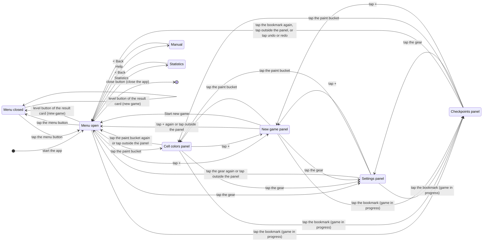

Images: [`screen-toolbar.png`](images/screen-toolbar.png) (menu open, new game, undo and redo gray),
[`screen-completed-menu.png`](images/screen-completed-menu.png) (menu open, complete puzzle, undo,
redo and the bookmark gray), [`manual-menu.png`](images/manual-menu.png).

### 9.1 Settings panel

The gear (top slot 2) opens the Settings panel. The panel is next to the gear, its top aligns with
the button, it is 400 px wide (x 1108–1507 for a left-handed player in portrait) and it has a 2 px
border. The Settings panel does not have the width of the Cell colors panel (owner approval 2026-11-04 and 2026-11-05).
It has five rows of 112 px with a 2 px line between them. The first three rows each have a name
(reMarkable Sans Medium, 25 px) and a switch at the right. The name in the third row has two lines of
text: **Color completed** and **groups** (owner approval 2026-11-04 and 2026-11-05). The fourth row
shows the version of the app. The fifth row is **Third-party licenses** ([§9.4](#94-third-party-licenses)).
A stable build (`v<version>`) and a preview build (`pre-<sha>`) have a sixth row for updates
([§9.2](#92-updates)).

| Row | Default | When the switch is off |
|---|---|---|
| **Highlight numbers** | On | A tap on a number does not make a highlight. A highlight that shows goes in the redraw of the change ([§6.2](#62-highlights); owner approval 2026-11-07). |
| **Hide pencil marks automatically** | On | All pencil marks of the empty cells show, also the digits that are numbers in the peers ([§6.1](#61-automatic-pencil-mark-hiding)). A tap on each micro-cell adds or removes its mark, and no x shows. |
| **Color completed groups** | On | No cell gets the completed color ([§6.4](#64-completed-groups)). A starting number keeps its starting color. The Completed groups section of the Cell colors panel stays operative, and its color stays not available for the other sections (owner approval 2026-11-04 and 2026-11-05). |

- A tap on a row changes its switch immediately. The panel stays open.
- The version row has the name **Version** (reMarkable Sans Medium, 25 px, black) at the left. The
  version is at the right, 33 px from the right edge of the panel (reMarkable Sans Regular, 25 px,
  black; owner decision 2026-10-31). A release build shows the version of its GitHub release (`pre-<sha>` or `v<version>`,
  with the version of Cargo.toml). A development install with a name for the change shows
  `dev/<name>`, for example `dev/update-icons` (owner decision 2026-11-05). All other builds show `dev`. A tap on the version row has no effect, and the panel stays open
  (owner decision 2026-10-26).
- A change of a switch does not change the numbers or the marks and is not a part of undo. When the
  highlight switch goes off, the highlight that shows goes in that redraw (owner approval 2026-11-07). The hiding switch changes immediately which
  pencil marks show. The completed-groups switch changes the colors of the board immediately. It also
  operates in the panel of a completed game, but a completed game shows no completed color
  ([§6.4](#64-completed-groups); owner approval 2026-11-04 and 2026-11-05). Changes that are already in the undo history do not change.
- The app keeps the switches when you close the app ([§14.2](#142-settings-kept-when-the-app-closes)).
- A switch that is on is a black track with a white knob at the right. A switch that is off is a white
  track with a black border and a black knob at the left. The track is 72×36 px with a 3 px border, and
  the knob has a diameter of 28 px. The switch ends 33 px from the right edge of the panel.
- While the panel is open, the gear is white on a black square (as the button of each panel).
- The switches are in a panel, and a highlight can show while the panel is open (owner approval 2026-11-07). When the
  highlight switch goes on, no highlight shows until the next tap on a number. A change of the hiding
  switch changes only which marks show ([§6.1](#61-automatic-pencil-mark-hiding)). It does not change the marks.
- The Highlighted numbers color stays available in the Cell colors panel when highlights are off.

Image: [`settings-menu.png`](images/settings-menu.png).

### 9.2 Updates

A stable build (version `v<major>.<minor>.<patch>`) looks for a newer stable release on GitHub and
installs it when the user taps a button (owner decision 2026-10-27). A preview build (`pre-` and 7 to
40 hexadecimal digits) also looks for updates and has the update row. Only a `dev` or `dev/<name>` build (and each
other version name) does not look for updates and does not have the update row (owner decision
2026-11-01).

**Look for an update.** The app reads two files of the latest stable release:

- `https://github.com/garbles/sudoku/releases/latest/download/version.json`:
  `{"version": "v<version>", "url": "<archive URL>", "sha256": "<checksum of the archive>",
  "patch_url": "<ink patch URL>", "patch_sha256": "<checksum of the ink patch>"}`. The ink patch
  ([§14.4](#144-launcher)) is a separate file of the release (`sudoku-penregion.qmd`), not a file in
  the archive (owner decision 2026-11-01). A release before this decision does not have `patch_url`
  and `patch_sha256`. The two fields are together or not at all, the URL must be HTTPS, and the
  checksum must be a SHA-256 checksum.
- `https://github.com/garbles/sudoku/releases/latest/download/version.json.sig`: the ed25519
  signature (64 bytes) of the bytes of `version.json`.

The app has the public key in its program. It uses `version.json` only when the signature is
correct. An update is available only when the version in `version.json` is newer than the version of
the app (compare major, then minor, then patch). A version that is the same or older is not an update.
A preview build cannot compare its name with a version. Thus for a preview build, each stable
release is an update, also a stable release that is older than the preview (owner decision
2026-11-01). The app does not look for preview releases.

- The app looks for an update automatically only when it opens. After that, it looks for an update
  only when the user taps the button **Check for updates** (owner decision 2026-10-31).
- If the app cannot get or examine the two files (for example, Wi-Fi is off), it does not try again
  automatically. The user can tap **Check for updates**.
- The request runs in the background. It never stops the game or the input.
- The app does not keep the result when it closes.

**Caution icon.** When an update is available, the gear has a caution icon at its top right: a red
(`#D62D20`) circle with a radius of 10 px and a white border of 3 px, with a white "!" in it. The
center of the circle is 16 px to the right of and 16 px above the center of the gear. The icon
stays until the app closes (also while the update installs and after it is installed). Image:
[`screen-toolbar-update.png`](images/screen-toolbar-update.png).

**Update row.** The sixth row of the Settings panel has the same height, lines and border as the
other rows. It shows one of these:

| State | Row |
|---|---|
| An attempt is not complete (when the app opens, or after a tap on **Check for updates**) | "Looking for updates..." |
| The attempts failed, and no attempt was successful | The button **Check for updates** |
| No update is available, and the attempt was complete while the Settings panel was open | "Sudoku is up to date", until the panel closes |
| No update is available (all other cases) | The button **Check for updates** |
| An update is available | The button **Update to v\<version\>** |
| The update installs | "Installing update..." |
| The installation failed | "Update failed" for 3 seconds, then the button again |
| The update is installed, and the ink patch did not change | "Restart Sudoku to update" |
| The update is installed, and it replaced the ink patch | The button **Restart interface** |

- The text of a state is reMarkable Sans Regular, 25 px, `gray25` (owner request 2026-11-07), at the left (33 px from the left
  edge of the panel). The baseline is 65 px below the top of the row.
- The two buttons have a black border of 2 px. They are 33 px from the left and the right edges of
  the panel, and from 22 px to 90 px below the top of the row. Each has an icon at the left (3 px
  round strokes, approximately 28 px), with its center 40 px from the left edge of the button. The
  text (reMarkable Sans Medium, 25 px, black) starts 72 px from the left edge of the button.
  - **Update to v\<version\>** has an update icon: a down arrow into a tray. Image:
    [`settings-update.png`](images/settings-update.png).
  - **Check for updates** has a circular arrow: an arc with a radius of 12 px, clockwise from the
    upper right (330 degrees, where 0 degrees is the right) through the bottom and the left to the
    top, with the gap at the upper right. A straight line continues the arc to the tip of an arrow
    head, 5 px to the right of the top. The head points to the right: two 7 px strokes, 45 degrees to
    each side of the line back from its tip. Image:
    [`settings-check-updates.png`](images/settings-check-updates.png).
- A tap on **Update to v\<version\>** starts the installation. A tap on **Check for updates** starts
  one attempt, and the row shows "Looking for updates..." until the attempt is complete. If the
  attempt finds no update, the row shows "Sudoku is up to date" until the Settings panel closes
  (owner decision 2026-10-31). When the panel opens again, the row shows **Check for updates**.
  Image: [`settings-up-to-date.png`](images/settings-up-to-date.png). A tap on
  the row in a different state, or next to the button, has no effect. The panel stays open, and the
  game does not change.
- A later successful attempt changes the row only from "Looking for updates...", **Check for
  updates** or **Update to v\<version\>**. A failed attempt does not remove an earlier result. After
  a failed attempt, the row shows the button that it showed before the attempt (**Check for
  updates** if no attempt was successful).
- "Restart Sudoku to update" is only a text. The user closes the app and opens it again from
  AppLoad. Then the new version operates (owner decision 2026-11-01).
- **Restart interface** has the same design as the other two buttons. Its icon is a power symbol:
  an arc with a radius of 12 px, with a gap at the top (from 300 degrees clockwise to 240 degrees),
  and a line from 15 px to 3 px above the center. Image:
  [`settings-restart.png`](images/settings-restart.png). xochitl reads the ink patch only when it
  starts, thus the reMarkable interface must start again (`/home/root/xovi/start`). A restart of
  the tablet is not sufficient, because it stops xovi ([§14.6](#146-installer)). A tap on the
  button does the same as **Restart** in the restart dialog (below), with no dialog.

**Restart dialog** (owner decision 2026-11-01). When the installation replaced the ink patch, a
dialog shows over the screen (also over a panel, the manual or the statistics). It has the same
design and position as the delete dialogs of the statistics ([§13](#13-statistics)):

- Title: "Restart the interface?". Text: "The update has a new ink patch. To use it," and "the
  reMarkable interface must start again.".
- Buttons: **Later** (black on white, left) and **Restart** (white on black, right).
- Before the dialog shows, the app reads the waiting ink. The highlight, the "?" and the x go away
  (the x: owner approval 2026-11-04). The highlight does not come back after **Later** (owner approval 2026-11-07). A pen or
  a finger that is on the screen has no more effect.
- While the dialog shows, only its two buttons operate (with the pen or a finger). All other taps
  and strokes have no effect.
- **Later** closes the dialog. The update row shows the button **Restart interface**.
- **Restart** saves the game. Then the app runs `/home/root/xovi/start` in a systemd unit of its own
  (`systemd-run`), because the stop of xochitl stops all processes of the xochitl service. The
  interface starts again with xovi and the new patch. The new version of the app operates when the
  user opens it again from AppLoad. If the app cannot start the script, the dialog closes, and the
  row shows the button **Restart interface**.

Images: [`update-restart.png`](images/update-restart.png) (the dialog),
[`settings-restart.png`](images/settings-restart.png) (the button after **Later**).

**Installation.** The app runs as root. Thus it installs only an archive and an ink patch that agree
with the signed `version.json`:

1. The app downloads the archive to `update/` in the data folder ([§14](#14-data-that-the-app-keeps)),
   not to `/tmp`. If `version.json` has `patch_url`, it also downloads the ink patch.
2. The SHA-256 checksum of the archive must be equal to `sha256` in `version.json`. The checksum of
   the ink patch must be equal to `patch_sha256`. The app examines the two checksums before it
   changes a file.
3. The app extracts the archive in `update/`. The archive must have the folder `sudoku/` with the
   program `sudoku` and `external.manifest.json`. It must not have links, or paths that go out of
   the folder.
4. The app moves the new folder next to the AppLoad folder of the app as `sudoku.new`. Then it
   renames the app folder to `sudoku.old` and `sudoku.new` to the app folder. If the second rename
   fails, the app renames `sudoku.old` back. The app never writes over the files of the app that
   operates. The program that operates continues with its old files.
5. The app deletes `sudoku.old` and `update/`. When the app opens, it also deletes a `sudoku.old`,
   a `sudoku.new` and an `update/` that stay from an earlier installation.
6. The app compares `patch_sha256` with the checksum in the stamp file of the ink patch
   ([§14.4](#144-launcher)). If the two are different, or the stamp file is missing or not correct,
   the app writes the new patch and then the stamp file with the new version and `patch_sha256`
   (each file with one rename). Then the dialog "Restart the interface?" shows. If the two are
   equal, the patch does not change. A release with no `patch_url` does not change the patch.

If step 1, 2, 3 or 4 fails, the app folder does not change, and the row shows "Update failed". If
step 6 fails, the row also shows "Update failed", and a new tap installs the release again.

### 9.3 Checkpoints panel

A **checkpoint** is a copy of all numbers, all pencil marks and the clock of the game at one time. The
player can save the board, continue, and later put the board back as one new action. The owner approved
this section on the tablet (prototype, 2026-11-06), with the exception of the items that give a
different source. Images: [`checkpoints-menu.png`](images/checkpoints-menu.png) (rows),
[`checkpoints-menu-empty.png`](images/checkpoints-menu-empty.png) (no checkpoint),
[`checkpoints-menu-current.png`](images/checkpoints-menu-current.png) (a row with "Current"),
[`checkpoints-menu-landscape.png`](images/checkpoints-menu-landscape.png),
[`checkpoints-menu-right-handed.png`](images/checkpoints-menu-right-handed.png),
[`screen-completed-menu.png`](images/screen-completed-menu.png) (the gray bookmark).

**The button.** The bookmark is in top slot 5 (y 560–671), below redo. It goes on the icon sheet.
[§15](#15-visual-specification) gives its shape.

- In a game in progress, the icon is black. A tap opens the panel. A second tap closes it.
- While the panel is open, the slot is black and the icon is white, as the other panel buttons.
- On a complete puzzle, the icon is `gray70`, a tap has no effect and the panel cannot be open (owner
  decision 2026-11-06). The tap changes nothing also when a different panel is open: that panel stays
  open. This is the only exception to the rule that a tap on a toolbar button that is not a panel button
  closes the open panel ([§9](#9-the-menu); approved prototype 2026-11-06). If a tap on the button reads waiting ink and that ink completes the puzzle, the
  panel does not open.

**The panel.** The panel touches the toolbar and is 600 px wide. Its top is at y 560 in all layouts. It
is white and has a 2 px black border, as the Settings panel.

| Layout | x range |
|---|---|
| Left-handed, portrait | 908–1507 |
| Left-handed, landscape | 1448–2047 |
| Right-handed, portrait and landscape | 112–711 |

The values below are for a left-handed player in portrait. In the other layouts, the contents have the
same order and move with the panel.

- **Save row**, y 560–671. A plus icon with its center at (966, 616). The text "Save checkpoint",
  reMarkable Sans Medium 28 px, x 1008, baseline y 625. A line of 2 px at y 670–671. The tap area is the
  full row. The icon and the text are black when a save is available. Else they are `gray70` and the row
  has no effect.
- **No checkpoint.** The panel ends at y 864. Two lines of text have their center at x 1207: "No
  checkpoints" (Regular 28 px, `gray25`, baseline y 760) and "Save the board before a difficult guess."
  (Regular 25 px, `gray25`, baseline y 800; owner request 2026-11-07).
- **Checkpoint rows.** The newest is first. There are at most 5 rows, and each row is 180 px high. Row i
  has its top at y0 = 672 + 180 i. The panel ends at y 672 + 180 n (y 1572 with 5 rows). Each row below
  the first has a line of 2 px at y0-2 to y0-1. A row has no title and no name.

Each checkpoint row has these items:

| Item | Position and size | Content |
|---|---|---|
| Small board | Origin (926, y0+14). Cells of 17 px: 153 px, 155 px with the outer lines. | The board of the checkpoint (below). |
| Text | x 1098, Regular 25 px, `gray25`. Baselines y0+81 and y0+115. | "\<clock\> played" (the format of [§8.3](#83-complete), the clock at the save) and "\<n\> of 81 cells" (n counts all filled cells, also the starting numbers). |
| Button | x 1289–1429, y y0+55 to y0+125 (these pixels are included). Text center x 1359, baseline y0+99, Medium 25 px. | **Restore**: white, 2 px black border, black text. **Current**: black, white text, when the numbers and all marks of the board are the same as the checkpoint. |
| Bin | The icon of the games list, center (1468, y0+90). Tap area x 1441–1507, the full row height. | Deletes the checkpoint. The 12 px between the button and this area operate nothing. |

The small board:

- Each filled cell has a background of 17×17 px and a digit: Regular 14 px, center x at cell + 8.5,
  baseline at cell + 14. The color of the digit is the same as on the board.
- The background is the first rule that applies: clash color, completed color (with the same switch and
  color rules as the board, [§6.4](#64-completed-groups)), starting color, white. The small board shows
  no highlight.
- Each visible pencil mark of an empty cell has a dot of 2×2 px, `gray25` (owner request 2026-11-07), at (cell x + 3 + 5 × ((d-1) mod 3),
  cell y + 3 + 5 × ((d-1) div 3)). The rule for a visible mark is the same as on the board, with the
  setting "Hide pencil marks automatically" ([§6.1](#61-automatic-pencil-mark-hiding)).
- The lines are 1 px `gray60` between the cells, and 2 px black at the box borders and the outside.

**Other taps.**

- A tap in the panel on no control has no effect.
- A tap outside the panel closes the panel ([§9](#9-the-menu)).
- A tap on undo or redo with this panel open only closes the panel. A second tap does the undo or the
  redo (owner decision 2026-11-06: keep two taps).
- The bookmark, the paint bucket, the gear and the + change the panel, as for the other panels.
- The eraser and a finger operate the panel in the same way as the pen, as the other panels.
- A release of a control in this panel reads waiting ink with the same rules as the other controls.

**Save.** A save is available when all of these are true: the game is in progress, there are fewer than
5 checkpoints, and no checkpoint has the same numbers and marks as the board. A save keeps the numbers,
the marks and the clock as the newest checkpoint. It does not change the board, the undo and redo history
or the clock. The app saves the game file.

**Restore.** A tap on **Restore** replaces all numbers and all marks with those of the checkpoint, as one
new item of the undo history ([§7](#7-undo-and-redo)). It removes the redo history. Undo returns the board
as it was, and redo applies it again, also after the delete of the checkpoint. The clock, the list and the
panel do not change, thus the panel stays open. A tap on **Current** has no effect and does not remove the
redo history.

The comparison uses all marks, also the marks that do not show ([§6.1](#61-automatic-pencil-mark-hiding)).
Thus a difference only in hidden marks shows **Restore**, and that Restore adds an undo item with no
visible change (review finding 2026-11-06).

**Delete.** A tap on the bin removes that checkpoint at once, with no dialog and no undo. The board, the
undo and redo history and the clock do not change. The app saves the game file.

**Guard after a delete** (owner decision 2026-11-06). For 0.5 s after a delete, with this panel open, a
press in the area of the panel at its maximum size changes nothing (portrait: x 908–1507, y 560–1572; in
the other layouts, the x range of the table above and the same y range). Thus the second tap of a fast
double tap does not delete the row that moved up, and it does not close the panel. A press out of that
area and on the toolbar operates as usual.

**The list.**

- The list has 0 to 5 checkpoints, all with different boards, the newest first. The clock of each
  checkpoint is at most the clock of the next newer checkpoint and at most the clock of the game (review
  finding 2026-11-06).
- A new game removes all checkpoints. The checkpoints stay when the app closes and opens, in the saved
  game ([§14.3](#143-game-in-progress-kept-when-the-app-closes)). A game that an earlier version saved has
  no checkpoints.
- Each change of the list causes a redraw, also a save and a delete in one wake (review finding
  2026-11-06).
- Each change of the list stops the other pen or finger gesture. Thus a release never operates a different
  checkpoint, for example when a finger stays on a control while the pen operates a different control
  (review finding 2026-11-06).
- The panel does not cover a toolbar button, the close button or the meter in any layout. It is not
  available on a complete puzzle, thus it never covers the result card ([§8.3](#83-complete)).
  The panel never has waiting ink or a stroke in progress (review finding 2026-11-06).

**Validity at load** (review finding 2026-11-06). The app examines each checkpoint and each board of a
Restore item in the undo and redo history when it reads the saved game:

- Each value is 0 to 9. The starting cells equal the solution and have no marks. The other marks are in 1
  to 9. The board is not solved.
- For a Restore item, the board before equals the board at that point of the history, and the board before
  is different from the board after.
- A checkpoint on a complete game is permitted. It stays in the file until a new game.
- A file that breaks these rules is incorrect saved data, as for the other rules of the saved game (PER-5):
  the app makes a new game.

### 9.4 Third-party licenses

The app shows the third-party components that the tablet program contains, and their licenses (owner
request 2026-11-07).

- **Data.** `scripts/licenses.py` makes `assets/licenses.json` from `cargo metadata` for the tablet
  target (`aarch64-unknown-linux-musl`). It starts at the crate of the app and follows only the normal
  dependencies. It does not follow the build dependencies, the dev dependencies and the proc-macro
  crates, because their code is not in the program. For each crate, the file keeps the name, the
  version, the SPDX license expression and the text of each license file of the package (`LICENSE*`,
  `LICENCE*`, `COPYING*`, `NOTICE*`, `UNLICENSE*`). A crate with no license file gets one sentence with
  the license of its Cargo.toml and its authors. The file also has two entries with no crate: the SQLite
  source in `libsqlite3-sys` (public domain, the version from `sqlite3.h`) and the UJI Pen Characters data
  of the recognizer (CC BY 4.0, [assets/README.md](assets/README.md)). The entries are in alphabetical
  order (no difference between capital and small letters), then in the order of the versions. The app
  contains the file. When `Cargo.lock` changes, run `python3 scripts/licenses.py`. A test fails when the
  file does not agree with `cargo metadata` (`--check`).
- **Settings row.** The fifth row of the Settings panel has the name **Third-party licenses**
  (reMarkable Sans Medium, 25 px, black) and a › (the icon of **All completed games**) with its center
  45 px from the right edge of the panel. A tap with the pen or a finger opens the Licenses list at
  page 1. The menu closes.
- **Licenses list.** The page units of the analytics screens ([§13](#13-statistics)). **< Back** and
  the title **Licenses**, then the `gray25` text "The app contains these open source components." Each
  row (97 units) has the name of the entry (Medium, 32) and its version (Regular, 30, `gray25`, at the
  right), and a › at the right end. The row does not show the license (owner decision 2026-11-07).
  Each page shows 14 rows in portrait and 9 rows in landscape. The ‹ › arrows and a finger swipe change
  the page. A tap on a row opens its license text at page 1. **< Back** shows the game with the menu open
  and no panel, and the toolbar ignores a press for 0.5 s ([§9](#9-the-menu)).
- **License text.** The title is the name of the entry. Below it is the line "Version <version> ·
  <license>" (Regular, 30, `gray25`; owner request 2026-11-07). In the license expression, each ` OR ` shows as ` / `, for example
  `MIT / Apache-2.0` (owner decision 2026-11-07). `AND` and `WITH` do not change. Then, for each license
  file: its name (Medium, 28), an empty line, and its text (Regular, 25), with lines of 36 units. A line
  of more than 80 characters breaks at the last space before the limit (or at the limit if there is no
  space). Each page shows 40 lines in portrait and 27 lines in landscape. The ‹ › arrows and a finger
  swipe change the page. **< Back** shows the Licenses list at the same page.
- A turn of the tablet keeps the first entry (list) or the first line (text) of the page on the new
  page. The app does not keep the state of these screens: after a close, it starts on the game.

Images: [`licenses.png`](images/licenses.png) (the first page of the list) and
[`licenses-text.png`](images/licenses-text.png) (the first page of the UJI Pen Characters text), and
their landscape versions.

## 10. Cell colors panel

Images: [`images/color-menu.png`](images/color-menu.png),
[`images/color-menu-landscape.png`](images/color-menu-landscape.png),
[`images/color-menu-right-handed.png`](images/color-menu-right-handed.png).

The positions, the sizes, the sections and the colors of this section have the owner approval 2026-11-04 and 2026-11-05, on the tablet.

- The panel opens next to the paint bucket. The top of the panel aligns with the button. The panel
  touches the toolbar and has a 2 px border.
- The panel is **800 px wide** (two columns of 400 px) and has three rows of 360 px: **y 112 to 1192**.
  It fits in landscape. The x range is:

  | Layout | x range |
  |---|---|
  | Left-handed, portrait | 708–1507 |
  | Left-handed, landscape | 1248–2047 |
  | Right-handed, portrait and landscape | 112–911 |

- The panel has five sections in two columns. The order of the columns is the same for the two hands:

  | Row | Left column | Right column |
  |---|---|---|
  | y 112 | **Starting numbers** | **Completed groups** |
  | y 472 | **Clashing numbers** | **Micro-cell lines** |
  | y 832 | **Highlighted numbers** | Empty space |

- A vertical line of 2 px is between the columns, the full height of the panel, at 400 px from the left
  of the panel. Each section below the first of a column has a horizontal line of 2 px at its top,
  across its column. There is no line below the Micro-cell lines section. The space below that section
  is plain white.
- Each section has a title (reMarkable Sans Medium, 25 px), 33 px from the left of its column, and a
  3×3 grid of cells, 112 px wide and 90 px high. The grid starts 32 px from the left of its column.
  Each cell has a color dot of 38 px and the name below the dot. The pen-color menu of the device has
  the same design.
- A tap on the empty space or on a title changes nothing, and the panel stays open.
- The panel does not cover a toolbar button, the close button or the meter in any of the four
  layouts. On a complete puzzle, it can cover a part of the result card (owner decision 2026-11-07,
  [§8.3](#83-complete)). The panel covers approximately 27 cells of the board in portrait and 24 in
  landscape. The owner accepted this size.
- A solid black box with white text shows the selected color.
- The available colors are Gray, White, Yellow, Blue, Red, Green, Cyan, Magenta and Orange.
  Black is not available. [§15](#15-visual-specification) gives their values.
- The default colors are: Starting numbers **Gray**, Clashing numbers **Red**, Highlighted numbers
  **Cyan**, Completed groups **Green**.
- **The four color sections (Starting numbers, Clashing numbers, Highlighted numbers and Completed
  groups) must use different colors. White is the only exception.** All four can use White.
- If a color section uses a color, the other color sections show that color as not available. The ring
  and the name are gray, and a line goes through the dot. You cannot select it. White is always
  available.
- When you tap an available color, the app selects it for that section immediately. The board
  shows the new color immediately. The app keeps the selection when you close the app.
- The **Completed groups** section selects the completed color ([§6.4](#64-completed-groups)). White
  means "no completed color". The section stays operative when the switch "Color completed groups"
  ([§9.1](#91-settings-panel)) is off, and its color stays not available for the other sections.
- The **Micro-cell lines** section selects the gray of the micro-cell lines (§4.1). Its nine items
  are, from the top left: **None** (no lines, a white dot), then the grays 90, 80, 70, 60, 55, 50,
  45 and 40 (ImageMagick `grayN`: N percent of white). The dot of each gray item shows the pattern of
  its gray inside its ring, the same pattern as the lines of the board ([§4.1](#41-types-of-cell)): a
  white disc with a radius of 17.5 px inside the 19 px circle with its 2 px ring, and the pattern of
  `gray15` dots over the white. The pattern starts at the pixel (cx − 19, cy − 19), the top left of
  the box of the 19 px circle with the center (cx, cy): `floor(cx − 17.5) − 1` for the integer
  centers. The disc uses the plain orientation `matrix[dy mod 4][dx mod 4]`, thus all 16 entries of
  the matrix: its density is the quantity of entries m with `m × 16 + 8 <= 255 − gray` out of 16
  (gray90 2, gray80 3, gray70 5, gray60 6, gray55 7, gray50 8, gray45 9, gray40 10 of 16), not the
  density of the lines (owner decision 2026-11-08). The None dot stays white. The selected item keeps its black box and its white ring. The other four sections (the
  colors) do not change (owner approval 2026-11-08). The default is **90**.
  All items are always available. A tap selects the gray immediately, and the board shows the new
  lines immediately. The app keeps the selection when you close the app. Images:
  [`color-menu-lines-90.png`](images/color-menu-lines-90.png) and
  [`color-menu-lines-40.png`](images/color-menu-lines-40.png).

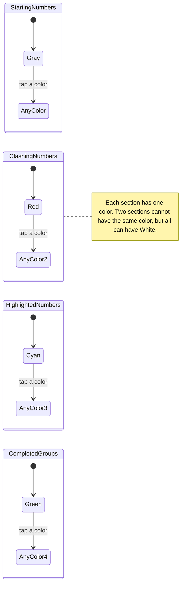

## 11. New game panel and difficulty

Images: [`images/new-game-menu.png`](images/new-game-menu.png),
[`manual-new-game.png`](images/manual-new-game.png).

- The panel opens next to the + button (bottom slot). The + button becomes white on black.
- The panel is 506 px wide. This is wider than the menus of the device, so that the slider is easy to
  use.
- The panel has three rows (owner approval 2026-11-07; before: two rows). From the top:
  1. The **difficulty slider** ("Easy", seven stops, "Hard").
  2. **Symmetrical**, with an on/off switch (owner approval 2026-11-07).
  3. **Start new game**, next to the + button.

  A 2 px black divider is between each two rows.
- Each row is one toolbar slot high (112 px). The panel top is at the top of the bottom toolbar slot
  − 226 px (portrait: y 2048 − 226 = 1822; before: 1936). The slider row is from the panel top, 112 px
  high, with the slider at its center (panel top + 56). The Symmetrical row is the 112 px directly
  above the bottom toolbar slot: its center is 56 px above the top of the bottom slot. Start new game
  does not move. The width (506 px) and the x position do not change (owner approval 2026-11-07).
- The slider has the same size and design as the meter below the board.
- The label **Symmetrical** is reMarkable Sans Medium 25 px, black, at the same x as the "Easy" label
  and the "Start new game" text (panel left + 33), with its baseline at the row center + 9. The switch
  is the same as the switches of the Settings panel ([§9.1](#91-settings-panel)): the same drawing,
  the same size and the same on and off looks. Its right edge is 33 px from the right edge of the
  panel, and it is at the vertical center of the row (owner approval 2026-11-07).
- A tap anywhere on the Symmetrical row changes the switch: on to off, or off to on. The press and the
  release must be on the row, the same as the other controls of the panels (owner approval
  2026-11-07).
- **Symmetrical** means 2-way rotational symmetry (a half turn of the board, 180°): cell (r, c) has a
  starting number if and only if cell (8 − r, 8 − c) has a starting number
  ([§14.5](#145-puzzle-generation)).
- There are **seven modes**, from 0 (Easy) to 6 (Hard). Each mode has a level of solving techniques,
  from singles to chains; a mode with a more difficult level needs more difficult techniques. The
  puzzle generator sets the techniques of each mode ([§14.5](#145-puzzle-generation)).
- When the panel opens, the slider shows the **last mode that you selected**. At the first start, the
  slider shows **mode 2**.
- When the panel opens, the switch shows the **symmetry of the last new game** (the saved setting,
  [§14.2](#142-settings-kept-when-the-app-closes)). At the first start, the switch is **on**. Example:
  after the player starts a game that is not symmetric, the switch is off the next time that the panel
  opens (owner approval 2026-11-07).
- When you move the slider or change the switch, only the selection changes. The game does not change
  until you tap **Start new game**. If the panel closes without Start new game (tap + again or tap
  outside), the app does not keep the selection of the slider or of the
  switch (owner approval 2026-11-07 for the switch).
- **Start new game** replaces the current puzzle immediately. The app does not ask for a
  confirmation. Then the app:
  - Makes a new puzzle of the selected mode, with the selected symmetry.
  - Closes the New game panel. The menu stays open.
  - Removes the undo and redo history and all checkpoints, and sets the clock to zero.
  - Keeps the selected mode and the selected symmetry for the next time.
- The meter below the board shows the mode of the current puzzle. When the puzzle is complete,
  the result card replaces the meter ([§8.3](#83-complete)). You cannot change the meter.
- On a complete puzzle, the level buttons of the result card (**Easier**, **Same**, **Harder**) also
  start a new game, at the mode − 1, the same mode or the mode + 1. They do the same steps as
  **Start new game**, but the menu closes ([§8.3](#83-complete); owner approval 2026-11-07). The new
  game has the symmetry of the completed game, and this symmetry becomes the saved setting. The card
  has no switch and shows no symmetry information (owner approval 2026-11-07).
- While the New game panel is open, the app makes the puzzle of the next game in the background, with
  the selected mode and the selected symmetry. A change of the slider or of the switch starts the
  background puzzle again for the new selection (owner approval 2026-11-07 for the symmetry).
  While the result card shows, it makes the puzzle of **Same** in the background from the completion,
  with the symmetry of the completed game ([§8.3](#83-complete)). The puzzle is the same as a puzzle
  that the app makes at the time of need.

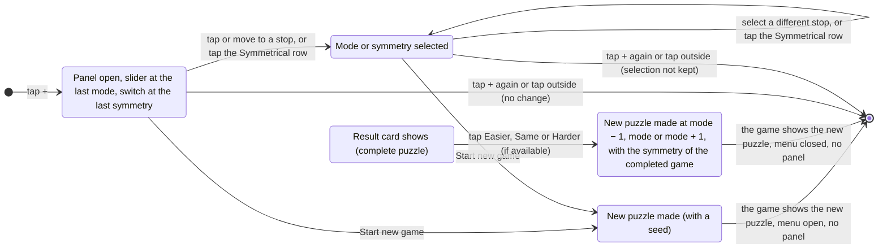

## 12. Manual (Help)

**Help** in the menu opens the manual. The manual has nine pages.

- Each page has **< Back** at the top left. It shows the game again, with the menu open and no
  panel open. For 0.5 s, the app ignores a press on the toolbar and on the close button ([§9](#9-the-menu)).
- Each page has ‹ › arrows next to the page number at the bottom. The arrow at the first page and the
  arrow at the last page are gray.
- A **finger swipe** to the left or to the right turns the page. reMarkable notebooks operate in the
  same way.
- The manual always opens at page 1.

| Page | Image | Content |
|---|---|---|
| 1 | [`manual-how-to-play.png`](images/manual-how-to-play.png) | The rules (rows, columns, boxes), starting numbers and your numbers, the close and menu buttons, the note that only the pen closes the game, how to turn the pages. |
| 2 | [`manual-candidates.png`](images/manual-candidates.png) | Micro-cells and pencil marks: how to add and remove them. |
| 3 | [`manual-pen.png`](images/manual-pen.png) | How to write and erase a number. |
| 4 | [`manual-pen-rules.png`](images/manual-pen-rules.png) | Taps, finger touches, one number for each cell, writing with no effect, the "?". |
| 5 | [`manual-helpers.png`](images/manual-helpers.png) | Automatic pencil mark hiding, highlights and completed groups. A full group with no clash gets the completed color. The color is not a check against the solution. A clash with a cell outside the group stops the color (owner approval 2026-11-04 and 2026-11-05). You can turn each helper off in the Settings panel. One sentence, in portrait and in landscape, tells about the x of a refused tap ([§6.1](#61-automatic-pencil-mark-hiding); owner decision 2026-11-04). The text is exactly: "If you tap the micro-cell of a hidden digit, the tap has no effect and a small x shows there for a moment." |
| 6 | [`manual-mistakes.png`](images/manual-mistakes.png) | Clashes and how to correct them. |
| 7 | [`manual-menu.png`](images/manual-menu.png) | All the menu buttons, how to select colors, and the Settings panel: the helpers, the version and the third-party licenses ([§9.4](#94-third-party-licenses)). |
| 8 | [`manual-new-game.png`](images/manual-new-game.png) | How to start a new game, and the meter of the current difficulty. One short sentence, in portrait and in landscape, tells about the Symmetrical switch, for example: "Symmetrical makes a puzzle whose starting numbers are the same after a half turn of the board." If the page shows the New game panel, the picture shows the panel with three rows (owner decision 2026-11-07). |
| 9 | [`manual-finished.png`](images/manual-finished.png) | Completion, the lock, the clock and the saved results. A completed game shows no completed color. The crop of the board shows the result card. The text tells that the level buttons of the card (Easier, Same, Harder) start a new game; it does not tell "To start a new game, tap + in the menu" (review finding 2026-11-07). |

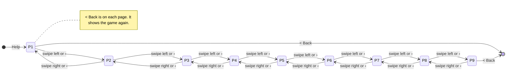

## 13. Statistics

### 13.1 Summary

Image: [`images/analytics.png`](images/analytics.png).

- **< Back** shows the game again, with the menu open and no panel open. For 0.5 s, the app ignores a
  press on the toolbar and on the close button ([§9](#9-the-menu)).
- Two boxes show **Puzzles completed** (the quantity of saved results) and **Average time** (the
  average of their times).
- The **By difficulty** table has one row for each mode, from Easy to Hard. Each row shows the
  difficulty meter, the quantity of completed puzzles and the average time. If a mode has no results,
  its average is "–". The rows are 97 units high in portrait and 76 units high in landscape, so that
  the seven rows and the buttons below them fit on the landscape page.
- **All completed games ›** opens the list.
- **Delete all games** is a button with a bin icon at the right of "All completed games ›", in the same
  row (in portrait and in landscape). A tap on it opens a **confirmation dialog** at the center of the
  summary. The summary becomes pale. The dialog has the same design as the delete dialog of the list
  and shows:
  - "Delete all games?"
  - "All N completed games are deleted." (N is the quantity of all saved results, with no filter.
    If N is 1: "1 completed game is deleted.")
  - "You cannot undo this action."
  - **Cancel** and **Delete**. Delete is black.
- **Delete** removes all results from the database and closes the dialog. The summary then shows 0 and
  "–". **Cancel** closes the dialog and makes no change. While the dialog shows, the summary accepts no
  other input. Image: [`analytics-delete-all.png`](images/analytics-delete-all.png).
- If there are no results, "Delete all games" is gray and has no effect.
- If there are no results, the two boxes show 0 and "–", and all rows show 0 and "–".

### 13.2 Completed games list

Image: [`images/analytics-games.png`](images/analytics-games.png).

- **< Back** shows the summary again.
- The **filter** row has **All** and one segment for each mode. Each mode segment shows its meter. The
  meters in the segments are smaller (18 units between the stops, not 34), so that they fit in the
  segments. The selected segment is black. The list opens with All selected.
- The columns are **Date** (date and time of completion, for example "22 Oct 2026, 20:22"),
  **Difficulty** (meter), **Time** (`m:ss` or `h:mm:ss`) and a **bin** button. The newest game is
  first.
- Each page shows **12 games** (6 games in landscape, [§3.3](#33-landscape)). The ‹ › arrows and finger swipes change the page. A change of filter
  shows page 1.
- A tap on a bin opens a **confirmation dialog** on the list. The list becomes pale. The dialog shows:
  - "Delete this game?"
  - The date of the game and its time.
  - "You cannot undo this action."
  - **Cancel** and **Delete**. Delete is black.
- **Delete** removes the result from the database. The list and the summary then show the change.
  **Cancel** closes the dialog and makes no change. Image:
  [`analytics-delete.png`](images/analytics-delete.png).
- If you delete the last game on a page, the list shows the page before it. The page number does not
  go below 1.
- If no results agree with the filter, or if there are no results, the list shows no rows.

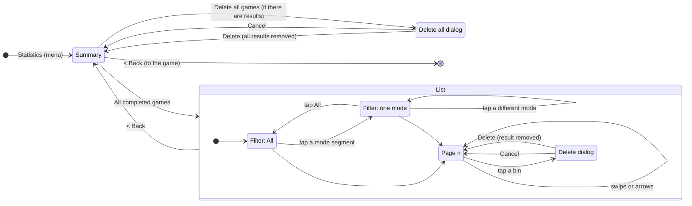

## 14. Data that the app keeps

### 14.1 Results database (SQLite)

The database has one row for each completed puzzle:

| Column | Meaning |
|---|---|
| `id` | Primary key |
| `finished_at` | Date and time of completion |
| `mode` | Difficulty, from 0 (Easy) to 6 (Hard) |
| `givens` | Quantity of starting numbers |
| `seconds` | Time that the player used (clock time, [§8.4](#84-the-clock)) |
| `seed` | Random seed of the puzzle generator. With the seed (and the mode, the version and the symmetry), the generator can make the same puzzle again. |
| `generator` | The version of the generator that made the puzzle ([§14.5](#145-puzzle-generation)). The seed gives the same puzzle only with the same version. |
| `symmetric` | True if the puzzle is symmetric ([§14.5](#145-puzzle-generation)). With `seed`, `mode`, `generator` and `symmetric`, the generator makes the same puzzle again. The rows of a database of an earlier version get false (owner decision 2026-11-07). |

Symmetric and non-symmetric games share the averages and the best times (Statistics
[§13.1](#131-summary) and the comparison of the result card, [§8.3](#83-complete)): only the mode sets
the group. The completed games list ([§13.2](#132-completed-games-list)) does not show the symmetry
and does not filter by it (owner decision 2026-11-07).

The app adds a row when a puzzle is complete. Only the bin in the games list and **Delete all games** on the summary remove rows.

### 14.2 Settings (kept when the app closes)

- The starting-number color, the clash color, the highlight color and the completed color.
- The gray of the micro-cell lines (default: 90). A settings file of an earlier version does not
  have it: the app uses the default.
- The last selected difficulty mode (default: mode 2).
- The last selected symmetry: the symmetry of the last new game (default: on). A settings file of an
  earlier version does not have it: the app uses on (owner approval 2026-11-07).
- The three switches of the Settings panel: highlight numbers (default: on), hide pencil marks
  automatically (default: on) and color completed groups (default: on). A settings file of an earlier
  version has the name `auto_remove_on` for the second switch. The app reads it.

**A settings file of an earlier version** (owner approval 2026-11-04 and 2026-11-05, except the rule
for a file that breaks COL-5):

- A file that has no completed color, and whose three colors agree with COL-5: if the highlight is
  Green, it becomes Cyan, or the first free color in panel order that is not White if Cyan is in use.
  The completed color then becomes Green, or the first free color in the same way. A highlight of
  another color, also White, does not change. The switch "Color completed groups" is on.
- A file that already has a completed color does not change, also with a Green highlight.
- A file that breaks COL-5 before this step goes to the defaults. This rule applies PER-5 to an
  earlier settings file (source: PER-5 and a review finding; the owner did not examine it on the
  tablet).
- The result of each start is the same. The file changes only at the next change of the settings.

### 14.3 Game in progress (kept when the app closes)

The app saves the current game continuously. When the app opens again, the game is exactly the same.
The app keeps:

- The puzzle, its seed, its mode, its symmetry (on or off) and the version of the generator. A game
  file of an earlier version has no symmetry: the game is not symmetric. A symmetric game is always
  generator version 2: the app does not use a saved game that is symmetric with version 1 (PER-5).
  When the app opens a saved game, it makes the puzzle again from the seed, the mode, the symmetry and
  the version, and compares it with the saved puzzle (PUZ-5; owner approval 2026-11-07).
- All numbers and pencil marks.
- All of the undo and redo history, with each Restore ([§9.3](#93-checkpoints-panel)).
- The checkpoints, each with its numbers, its marks and its clock (owner approval 2026-11-06). A game
  that an earlier version saved has no checkpoints.
- The time on the clock.
- The completion state.

When the app closes, no progress is lost. A power loss can lose a maximum of 5 seconds of the clock,
because the app saves the clock each 5 seconds (owner decision 2026-11-02). All other data is saved
after each change, also after each save and each delete of a checkpoint (owner approval 2026-11-06).

An earlier version cannot read a saved game with the new undo item of a Restore. Thus an update to an
older version loses that game. A preview build can update to an older stable version (review finding
2026-11-06; refer to `DECISIONS.md`).

An earlier version does not know the symmetry. For the seed of a symmetric game, it makes a different
puzzle, thus it discards that saved game after an update to an older version (owner approval
2026-11-07).

The app does **not** keep temporary UI states. The app always opens again at the game screen, with
the menu open, the panels closed, no highlight, no "?" and no x. The app does not save the x (owner
approval 2026-11-04). The app does not save the completed color of a group: it comes from the numbers
([§6.4](#64-completed-groups); owner approval 2026-11-04 and 2026-11-05). If the app closes during the recognition pause, the app removes the ink and does
not read it.

### 14.4 Launcher

The Paper Pro cannot start third-party apps without a launcher. The app uses **AppLoad**
(asivery/rm-appload). AppLoad is the most frequently used launcher on the Paper Pro. AppLoad is a
xovi extension. It operates apps in the reMarkable interface. To install it, use the community
package manager **Vellum**:

1. `vellum add appload`. This installs xovi, xovi-extensions, qt-resource-rebuilder and AppLoad. On
   OS 3.29 the package `launcherctl-appload` does not install, because its dependency
   `lockscreen_hook` supports only OS versions before 3.28.
2. `/home/root/xovi/rebuild_hashtable`.
3. Copy the ink patch `dist/sudoku/sudoku-penregion.qmd` to
   `/home/root/xovi/exthome/qt-resource-rebuilder/`, and write its stamp file
   `sudoku-penregion.json` next to it.
4. `/home/root/xovi/start`. Then `/home/root/.vellum/bin/vellum update` and
   `/home/root/.vellum/bin/vellum add tripletap` (the power-button starter). After a restart of the
   tablet, xovi is off and AppLoad is not in the menu. Press the power button 3 times to start xovi.
   The screen starts again after some seconds. After an update of the tablet software, Vellum is
   stale: run `/home/root/.vellum/bin/vellum upgrade` and `/home/root/.vellum/bin/vellum reenable`,
   then `/home/root/xovi/rebuild_hashtable` and `/home/root/xovi/start` again (owner report
   2026-11-03).
5. Copy the folder `dist/sudoku` (from the Dockerfile) to `/home/root/xovi/exthome/appload/`.

The installer (§14.6) does these steps automatically.

**Ink patch** (owner decision, 2026-11-01). With the UI waveform of the window, the ink had gaps
while the pen wrote (DECISIONS.md). The ink patch is a QML patch of AppLoad for qt-resource-rebuilder.
It puts an area with the Pen screen mode of xochitl (the fast pen waveform) in the window of the app.
The app gives the area in `/tmp/sudoku-pen-region` ("x y width height", or empty), and the patch
reads it each 15 ms. The values are in the coordinates of the window of AppLoad: the screen as the
player sees it, in each rotation of the tablet. AppLoad turns only the drawing of the framebuffer, not
the items of its window. In portrait they are the framebuffer coordinates; in landscape a framebuffer
rectangle puts the area on a different cell, and the ink gets the UI waveform (owner report
2026-11-08: choppy ink with gaps, only in landscape):

- While the player writes in a cell, the area is the inside of that cell, aligned inward to 4 px.
  It does not touch the cells around it, because xochitl refreshes the full area when it starts and
  when it stops.
- Each pen press on an empty cell starts the area at the pen down, also a tap and also the first
  stroke of a session: the ink is smooth from the moment the pen touches the cell. A press on a
  different empty cell moves the area to that cell at the pen down, with no stop between the cells
  (owner request 2026-11-07; before, the first stroke of a session started the area when the pen left
  the micro-cell, and a tap at that time did not start it). Measured with the update log of xochitl
  before this change: 52 to 56 ms from the pen down to the first ink of a stroke that starts the area
  at the pen down, with the pen waveform (DECISIONS.md).
- A tap on an empty cell: its mark or its x goes to the screen at the pen lift, inside the area, with
  the pen waveform, and the ink of the tap goes away with it. Only the changed pixels go, inside the
  micro-cell. The area does not stop and does not change at the lift: xochitl refreshes the full area
  when it stops or when it changes, and this would refresh the full cell and show the ink of the tap
  again (owner request 2026-11-07). A tap that is shorter than the time that the patch needs to apply
  the area (45 ms): the mark waits for that time.
- The area stays on its cell when the pen lifts. It changes only in these cases: a pen press on a
  different empty cell moves it (above); a redraw that needs the UI waveform inside the cell stops it
  first (a number or a "?" in the cell, a change of the micro-cell lines, a panel, a dialog or a
  different screen over the cell): the redraw goes when the patch applied the stop (45 ms); the cell
  becomes filled (a Redo or a Restore): the area stops at once; a turn of the tablet stops it. The pen
  waveform shows the pencil marks, the x and the ink of the cell (exactly black or `gray15` on white:
  these three drawings have no anti-aliasing, [§15](#15-visual-specification)): a redraw
  with only these changes in the cell goes with the area on. Thus the end of the x also goes inside
  the area, in the micro-cell. The area never covers a filled cell (owner request 2026-11-07).
- A pen touch that starts on a filled cell starts no area ([§5.1](#51-rules); owner approval 2026-11-07).
- The ink waits until the patch can apply a new area (45 ms). A redraw also waits for it, so that a mark
  gets the pen waveform and colored cells get the UI waveform.
- While the player writes, a redraw waits. The writing starts with the first stroke on the board.
  It stops when the app has read the last ink and the pen has written nothing on the board for
  **1 s** after the last stroke (one timer for all cells: each new stroke starts it again). This
  time is equal to the recognition pause (§5.1; owner approval 2026-11-07). A pen press that does not write (a tap, the
  eraser, a button) stops the writing immediately. A finger press does not stop it. A control that a
  finger operates stops it at its release, on the control (owner approval 2026-11-07). The app
  reads each number after the recognition pause (§5.1), but the typed numbers show only when the
  writing stops. Thus the player can write in many cells, one after the other, also with a slow
  movement to the next cell: only the ink changes on the screen, and an update with the UI waveform
  does not stop the ink in the next cell (owner decision 2026-11-02). Ink in the area does not wait
  for an older update there. The pixels of the x or of the "?" also wait for this redraw, thus they
  can stay under the ink until the writing stops (§5.1; owner decision 2026-11-04).
- xochitl reads the patch only when it starts. The app uses the area only if the patch was installed
  before xochitl started. Without the patch, the app sends the ink so that an update never touches
  changed pixels of an update in progress.
- An update of the tablet software or of AppLoad can stop the patch. Then the window opens, but the
  ink can have gaps.

**Crisp pixels in the pen area** (owner approval 2026-11-07, on the tablet). The pixel conversion of
xochitl for the pen waveform sends gray pixels (the anti-aliased edges of a drawing) through the
color dither of the panel. Thus the ink of the pen, the pencil marks and the x have no anti-aliasing:
each pixel of these drawings is fully the color of the drawing (black for the ink, `gray15` for the
marks and the x) or the pixel that was under it. The gain comes from the crisp pixels, not from a
different waveform. The board lines and the micro-cell lines also have no anti-aliasing (owner
approval 2026-11-08): the board lines are black on full pixels, and the micro-cell lines show the
selected gray as a pattern of `gray15` and white pixels ([§4.1](#41-types-of-cell)). The panel has no
gray particle: a flat gray pixel is a colored dither on the panel, and a 16×16 tile with 16 or more
flat gray pixels loses the clean text path for the digits in it. Thus a lighter line must be a
pattern of dark and white pixels. All other drawings keep their anti-aliasing: the numbers, the "?",
the menu, the panels, the dialogs, the texts, the manual pages, the result card and the small boards
of the Checkpoints panel (their mark dots stay as they are). The micro-cell lines and the swatches of
the Micro-cell lines section ([§10](#10-cell-colors-panel)) are the only drawings that show a gray
as a pattern. The dots of the pattern are `gray15`, not black: the display code of xochitl gives a
rectangle that was pure black and white a mono waveform, and a color that then appears in it is
washed out or has a wrong tint (DECISIONS.md, 2026-11-07 iteration 1 and 2026-11-08 iteration 1
rejected). This is the behavior for all players: no setting, no
environment variable and no file changes it, and it is the same in all four layouts, in the first
frame, in a redraw, in the snapshot tool, in the bench and in the videos.

**Stamp file** (owner decision 2026-11-01). Next to the patch, the file
`/home/root/xovi/exthome/qt-resource-rebuilder/sudoku-penregion.json` gives the version that
installed the patch and the SHA-256 checksum of the patch:
`{"version": "v<version>", "sha256": "<checksum>"}`. The installer (§14.6) and the update of the app
(§9.2) write it each time that they install the patch. The update compares the checksum of the new
patch only with the checksum in this file. For the update, a missing stamp file means that the patch
must be replaced.

The close button shows the reMarkable interface again. AppLoad draws a black line of 2 px around the
window of each app, also in full screen. The app cannot remove it. The app does not put content at
the outer 2 px of the screen that is necessary to play.

### 14.5 Puzzle generation

A generator with a seed makes each puzzle. Each puzzle must have **only one solution**. The generator
makes the puzzle for the selected mode. Each mode has a most difficult group of techniques (a
level). The puzzle of a mode needs a technique of its level, and no technique of a more difficult
level. No mode needs a guess, and no mode needs a technique that assumes that the puzzle has only one
solution (owner decision, 2026-10-25):

| Mode | Level: the techniques that the mode adds | Starting numbers |
|---|---|---|
| 0 (Easy) | Singles: full house, naked single, hidden single | 44 (symmetric: 44 or 45) |
| 1 | Singles | As few as possible |
| 2 | Locked candidates: pointing, claiming | As few as possible |
| 3 | Naked and hidden pairs, triples and quads | As few as possible |
| 4 | X-Wing, Swordfish, XY-Wing | As few as possible |
| 5 | Skyscraper, 2-String Kite, XYZ-Wing, W-Wing, simple colouring, Jellyfish | As few as possible |
| 6 (Hard) | X-Chain, XY-Chain and other alternating inference chains (AIC) | As few as possible |

A human-style solver (`src/solver.rs`) uses these techniques, from the easiest to the most difficult.
For each attempt, the generator:

1. Makes a full, correct grid.
2. Removes starting numbers in a random order. A removal stays only if the solver, with only the
   techniques of the level of the mode, can complete the grid. Thus the puzzle has only one solution.
   Easy stops at 44 starting numbers.
   A **symmetric** puzzle removes a cell and its partner together, in a random order of the pairs.
   The partner of cell (r, c) is cell (8 − r, 8 − c). The center cell (4, 4) has no partner: it is
   removed alone. A removal of a pair stays only if the solver (with only the techniques of the level
   of the mode) can complete the grid; else the two cells come back. A symmetric Easy puzzle never
   goes below 44 starting numbers: the generator skips a pair that goes below 44, and continues with
   the other cells. Thus it has 44 or 45 starting numbers (owner decision 2026-11-07: accept 45).
   81 − 44 = 37 is odd, thus the center must be removed to get 44; when the solver needs the center,
   the puzzle stops at 45 (16 of 300 sample seeds gave 45). The other modes remove as many as
   possible, the same as a puzzle that is not symmetric.
3. Grades the puzzle with all techniques. If the puzzle does not need the level of the mode, the
   generator makes a new attempt (a maximum of 400 attempts). If no attempt of the 400 needs the
   level of the mode, the generator gives the attempt with the most difficult grade (the first of
   them). Then the level of the puzzle can be easier than the level of the mode (owner decision
   2026-11-02).

The generator uses its own random number generator (SplitMix64). Thus a change of a library does not
change the puzzle of a saved seed. The code is in `src/generator.rs`.

**Symmetry** (owner approval 2026-11-07). A symmetric puzzle has 2-way rotational symmetry (a half
turn, 180°): cell (r, c) is a starting number if and only if cell (8 − r, 8 − c) is a starting
number. The symmetry is an input of the generator: the puzzle is a function of the seed, the mode, the
symmetry and the version. A symmetric puzzle uses a different random sequence from the puzzle of the
same seed that is not symmetric. A puzzle that is not symmetric does not change: the same seed and
mode give the same puzzle as before the symmetry option, and the generator version stays 2. Version 1
has no symmetry. In tests on the computer, the symmetric puzzles of all modes got to the level of
their mode, and the slowest Hard puzzle took 23 ms. The puzzle of the next game that the app makes in
the background (`early.rs`) has the seed, the mode and the symmetry as its key.

**Versions.** A change of the generator gives a different puzzle for the same seed. Thus each game and
each result has the version of the generator. Version 1 (before 2026-10-25) had five modes (0 to 4) and
set only the quantity of starting numbers (44, 37, 31, 27, 24). The app keeps version 1 only to
examine a game that it saved before version 2. A game file with no version is version 1. When the
app opens a results database of version 1, it moves the rows to the new table with generator version
1. A row that the app cannot use stays in the file, in the table `results_v1`.

### 14.6 Installer

`install.sh` installs the app on the tablet from a computer (macOS or Linux). Each release has this
file. It installs the archive and the ink patch of its release. release.yml writes the version and
the two checksums into it. The command for the latest stable release is:

```bash
curl -fsSL https://github.com/garbles/sudoku/releases/latest/download/install.sh | bash
```

The installer has these requirements (owner decision, 2026-10-27):

- **One script.** All steps are in one file. A copy from git (with no version) installs the latest
  stable release.
- **Version.** In step 2, a menu asks for the version: "The latest version" (the default) or "A
  different version". "A different version" shows a second menu with all releases from the GitHub
  API, the newest first: the name, the type (`latest`, `stable` or `preview`) and the date (UTC).
  More than 10 rows scroll. In a terminal, the user moves with the arrow keys (or `j` and `k`),
  selects with Enter and stops with `q`. After the selection, the menu changes to one line with
  the version. With an input file (the tests), the rows have numbers and the user types a number.
  If GitHub does not give the list, the user types the name of the version. A name with characters
  other than letters, digits, `.`, `_` and `-` stops the installer.
  `SUDOKU_VERSION` selects a release with no question, for example `v0.1.2` or the preview version
  `pre-1a2b3c4` (`0.1.2` gets the prefix `v`). For a version that is not the latest, the installer
  reads the two checksums (archive and ink patch) from `version.json` of that release. If GitHub does not have the release, the
  installer stops. For a preview version, it shows a warning.
- **Idempotent.** Each installation step (4 to 11) examines the tablet or the computer first. If
  the step is done, the installer shows "(done already)" and does not change it. Steps 1 to 3 always
  operate: they examine the programs, download the release and connect. A second run with all steps
  done changes nothing on the tablet.
- **Instructions.** When the user must do something, a box tells the user what to do, step by step.
  Then the installer waits for Enter (or `q` to stop), and examines the step again.
- **Colors.** The output uses ANSI colors (256-color palette) and Unicode symbols. `NO_COLOR` turns
  the colors off.
- **Tests.** `tests/install/run.sh` runs the installer with fake `ssh`, `ssh-keygen` and `curl`
  programs. `tests/install.rs` examines the scenarios. `scripts/build.sh` makes the screenshots
  `images/install-*.png` from them. `tests/install/tty.py` runs a scenario in a terminal and
  pushes keys, for the images of the version menus.

The steps:

| Step | Examination | Action |
|---|---|---|
| 1. Programs | `ssh`, `ssh-keygen`, `curl`, `tar` and `sha256sum` or `shasum` | If a program is missing, the installer tells how to install it and stops. |
| 2. Download | – | Asks for the version (or uses `SUDOKU_VERSION`). For a version that is not the latest, downloads `version.json` of that release. Downloads `sudoku-<version>.tar.gz` and the ink patch `sudoku-penregion.qmd` of the release, and compares their SHA-256 checksums. If a checksum is not correct, the installer stops. A release with no `patch_sha256` has no separate patch: then step 8 does nothing. |
| 3. Connection | SSH to `REMARKABLE_HOST` if it is set, else to `10.11.99.1` (the USB cable). The installer tells which of the two it uses | No answer on USB: instructions for the USB cable. No answer on Wi-Fi (`REMARKABLE_HOST`): instructions for Wi-Fi, then a menu: "Try again" (Wi-Fi again) or "Use the USB cable" (the installer continues with `10.11.99.1`). Connection refused: instructions for developer mode (with the caution that it erases the tablet). Changed host key: the installer removes the old key after a confirmation. |
| 4. SSH key | `~/.ssh/id_ed25519_remarkable`, and the tablet accepts it | Makes the key (ed25519, no passphrase). Adds it to `/home/root/.ssh/authorized_keys`, with a different key of the computer or with the root password. The installer tells where the password is (Settings > General > Help > About > Copyrights and licenses). Shows the tablet model and software version. A tablet that is not a Paper Pro needs a confirmation. |
| 5. Vellum | `/home/root/.vellum/bin/vellum` | Examines the internet connection of the tablet (instructions for Wi-Fi). Downloads the latest Vellum bootstrap script on the computer (curl examines the TLS certificate) and runs it on the tablet. The installer keeps no checksum of this script, because each Vellum release changes it. |
| 6. AppLoad | `/home/root/xovi/extensions.d/appload.so` | Examines the internet connection of the tablet (instructions for Wi-Fi). Then `vellum update`, then `vellum add appload`. |
| 7. Hashtable | The state of Vellum after an update of the tablet software (the warning "reenable has not been run" from `vellum info remarkable-os`), and `/home/root/xovi/exthome/qt-resource-rebuilder/hashtab` | When Vellum does not report a change, the step skips when the hashtab file exists; else it tells the user that the screen stops for 1 to 2 minutes, then runs `xovi/rebuild_hashtable`. When Vellum reports a change, first tells the user "The tablet software changed. The installer updates Vellum and the xovi files." and examines the internet connection of the tablet (instructions for Wi-Fi). Then it tells the user that the screen stops for 1 to 2 minutes, shows "Updating Vellum after the tablet software change...", runs `vellum upgrade` and `vellum reenable`, and rebuilds the hashtable also when the hashtab file exists. If the command fails or Vellum still reports a change, the installer stops with "Vellum could not update the packages after the tablet software change." |
| 8. Ink patch | The SHA-256 checksum of `sudoku-penregion.qmd` in `xovi/exthome/qt-resource-rebuilder` and the checksum in its stamp file `sudoku-penregion.json` are equal to the checksum of the downloaded patch | Copies the ink patch (§14.4) to the tablet. The tablet examines the checksum before it replaces the patch. Then it writes the stamp file with the version of the installer and the checksum. If only the stamp file is missing or different, the installer writes it, and step 9 does not start xovi again. |
| 9. xovi | `xochitl` has `xovi.so`, step 8 did not replace the patch, and step 7 made no update after a change of the tablet software | Runs `xovi/start` (the user interface starts again). The patch operates only after this start. After a change of the tablet software, it shows "xovi must start again after the tablet software change." and starts xovi, also when xovi is on, after the message for the ink patch when that also applies. If step 7 showed the warning that the screen stops, this step does not show it again. |
| 10. Power button starter | The systemd unit `xovi-tripletap` is enabled and active | When the step is not done, shows the two information lines: "After a restart, xovi is off, and AppLoad is not in the menu." and "A triple press of the power button starts xovi again." Then examines the internet connection of the tablet (instructions for Wi-Fi), shows "Installing the power-button starter...", runs `vellum update`, then `vellum add tripletap`, and examines the service. If the service is not on, shows "Repairing the power-button starter...", runs the starter's `/home/root/xovi-tripletap/enable.sh` if it is present (else `vellum reenable` and `systemctl start xovi-tripletap`), and examines the service again. On success, shows "The power button starts xovi." If Vellum fails or the service is still not on, the installer stops before Sudoku. |
| 11. Sudoku | The SHA-256 checksum of the installed `sudoku` is equal to the checksum in the archive | Copies the archive to the tablet and replaces the AppLoad folder `sudoku` only after all checks. The saved data (§14.1–14.3) does not change. |

At the end, a box tells how to open the app. After a restart of the tablet, xovi is off and AppLoad
is not in the menu. Press the power button 3 times to start xovi. The screen starts again after some
seconds. The user does not run the installer again to start xovi after a restart. After an update of
the tablet software, the user runs the installer again: it updates Vellum and the xovi files, and it
starts xovi again (owner report 2026-11-03). The header comment of `install.sh` gives a new version
of Sudoku, for example, as the reason to run the installer again. It does not give a restart of the
tablet as a reason, because the power button starts xovi (owner decision 2026-11-03).

**Installer rules**. The tests give these IDs:

| ID | Rule | Source |
|---|---|---|
| INS-1 | The installer installs the power-button starter after it starts xovi and before it installs Sudoku. The new step is step 10 of 11; the Sudoku step is step 11; the header lists 11 steps. | owner decision 2026-11-03 |
| INS-2 | Step 10 is done exactly when `systemctl is-enabled xovi-tripletap` and `systemctl is-active xovi-tripletap` both succeed. When it is done, the installer shows "The power button starts xovi." with "(done already)" and changes nothing. A second run with all steps done changes nothing. | owner decision 2026-11-03 |
| INS-3 | When step 10 is not done, it examines the internet connection of the tablet first (the Wi-Fi box and the pause, as steps 5 and 6). Then it runs `vellum update`, then `vellum add tripletap`, and then examines the service. If Vellum fails, the installer stops with "Vellum did not install the power-button starter." If the service is not on, the installer tries the repair: the starter's `/home/root/xovi-tripletap/enable.sh` if it is present, else `vellum reenable` and `systemctl start xovi-tripletap`. Then it examines the service again. If the service is still not enabled and active, the installer stops with "The power-button starter is not on." Sudoku is not installed. | owner decision 2026-11-03 |
| INS-4 | After step 10 succeeds, the installer shows "The power button starts xovi." The step changes no other step and no app data. The two info lines are: "After a restart, xovi is off, and AppLoad is not in the menu." and "A triple press of the power button starts xovi again." | owner decision 2026-11-03 |
| INS-5 | The final box gives the approved restart lines: "After a restart, xovi is off. AppLoad is not in the menu." / "Press the power button 3 times to start xovi. The screen" / "starts again after some seconds." The installer shows the box only after step 11 succeeds. A run that does not reach step 11 does not show it. | owner decision 2026-11-03 |
| INS-6 | The starter starts xovi only on a triple press of the power button. It does not start xovi at boot. A triple press while xovi is on starts the interface again. | owner decision 2026-11-03 |
| INS-7 | When Vellum says that the tablet software changed (the warning "reenable has not been run"), the installer runs `vellum upgrade` and `vellum reenable` before it rebuilds the xovi hashtable. Then it rebuilds the hashtable even when the hashtab file exists, and step 9 starts xovi again. The step numbers do not change (step 7 and step 9; 11 steps in total). | owner report 2026-11-03 (bead remarkable-sudoku-3ed) |
| INS-8 | If `vellum upgrade` or `vellum reenable` fails, or Vellum still reports the stale state, the installer stops at step 7 with "Vellum could not update the packages after the tablet software change." It does not rebuild the hashtable, does not start xovi and does not install Sudoku. | owner report 2026-11-03 (bead remarkable-sudoku-3ed) |

The installer output keeps its limits: the box text has at most 66 columns, and the output lines have
at most 90 columns. The new lines have 57, 56 and 32 columns (box) and 61 and 53 columns (info)
(owner decision 2026-11-03). The lines of the tablet software change have 81, 55, 74 and 59 columns
(owner report 2026-11-03).

## 15. Visual specification

| Item | Value |
|---|---|
| Screen | 1620×2160, 229 DPI |
| Board | Cells of 147 px, micro-cells of 49 px, origin (148, 418) |
| Board lines | Box and border 13 px black; cell 3 px black. No anti-aliasing: each pixel is black or white. Before, each board line had one faint anti-aliased pixel (value 191 of 255) on its right or bottom side (at offset + 2 for a 3 px line, offset + 7 for a 13 px line), and the ends of the border had pixels of 143. With the crisp lines these pixels are white: the black pixels do not change, the faint edge pixels go away (§4.1; owner approval 2026-11-08) |
| Micro-cell lines | 2 px, at 49 px and 98 px from the cell origin and the pixel after, over the full cell. A pattern of `gray15` and white pixels with the darkness of the selected gray (default `gray90`, §10): ordered 4×4 Bayer dither, matrix `[[0, 8, 2, 10], [12, 4, 14, 6], [3, 11, 1, 9], [15, 7, 13, 5]]`, a pixel is `gray15` when `matrix × 16 + 8 <= 255 − gray`. The pattern starts at the first pixel of each line; the row index of the matrix is the position along the line (modulo 4), the column index is the position across it (0 the offset pixel, 1 the next): `matrix[dy mod 4][dx]` for a vertical line, `matrix[dx mod 4][dy]` for a horizontal line. No other gray and no intermediate value (§4.1; owner approval 2026-11-08) |
| Numbers | reMarkable Sans Regular 104 px; starting numbers black, your numbers dark gray (`#1E1E1E`; owner approval 2026-11-04 and 2026-11-05) |
| Pencil marks | reMarkable Sans Regular 31 px, `gray15`, at the center of their micro-cell. No anti-aliasing: each pixel is `gray15` or the pixel of the empty cell under it (owner approval 2026-11-07) |
| Ink of the pen (§5.1) | Black line of 5 px with round ends and joins; the ink of a tap is a dot with a radius of 2.5 px. No anti-aliasing: each pixel is black or the pixel under it, also over a filled cell (§14.4; owner approval 2026-11-07) |
| "?" | reMarkable Sans Regular 104 px, `gray25` (owner request 2026-11-07) |
| x of a refused tap (§6.1) | Two straight lines with round ends, line width 3 px, `gray15` (the same as the pencil marks). Each line goes from -10 px to +10 px on the two axes around the center: 20×20 px between the line centers, visible extent of approximately 23×23 px. The center is the anchor point of the pencil mark of that digit: 24, 74 or 122 px from the cell origin on each axis, at the keypad position of the digit (1 at the top left, 9 at the bottom right). The x stays in its micro-cell and does not touch the cell lines. Time: the same value as the "?" (1000 ms) (owner approval 2026-11-04). No anti-aliasing: each changed pixel is `gray15` (owner approval 2026-11-07). |
| Anti-aliasing | Only the ink of the pen, the pencil marks, the x, the board lines, the micro-cell lines and the icons (all icons of the app, also on the icon sheet `icons.png`; owner approval 2026-11-08) have no anti-aliasing. All other drawings have anti-aliasing: the numbers, the "?", the menu frame, the panels, the dialogs, the texts, the manual pages, the result card and the small boards of the Checkpoints panel with their mark dots. The micro-cell lines and the swatches of the Micro-cell lines section are the only drawings that show a gray as a pattern; no other gray becomes a black and white pattern (§14.4; owner approval 2026-11-07 and 2026-11-08) |
| Highlight | The same color rules as before (§4.2). It can also show while the menu or a panel is open, on the part of the board that the panel does not cover (§6.2; owner approval 2026-11-07) |
| Times of writing | Recognition pause 1000 ms from the pen lift. Redraw wait 1000 ms after the last stroke. A touch that starts less than 150 ms after a pen lift has no effect (§5.1, §14.4; owner approval 2026-11-07) |
| Palette | Gray `#AEAEAE`, White `#FFFFFF`, Yellow `#FFD740`, Blue `#408CFF`, Red `#FF8E8E`, Green `#48D630`, Cyan `#6FCFE6`, Magenta `#E650E0`, Orange `#FF9A1F` (owner approval 2026-11-04 and 2026-11-05). The board, the panel dots, the manual and the images all use this palette. |
| Default colors | Starting Gray `#AEAEAE`, clash Red `#FF8E8E`, highlight Cyan `#6FCFE6`, completed groups Green `#48D630` |
| Background of a filled cell | First rule that applies: clash, highlight, completed, starting number, white (§4.2) |
| UI text | reMarkable Sans Medium 25 px (menus, meter labels). The version value and the text of an update state are reMarkable Sans Regular 25 px (§9.1, §9.2). |
| Secondary text | `gray25` (`#404040`) for all secondary text and marks: the result card text, the "?", the box labels and the column headings of Statistics and of the completed games list, the help line of the Checkpoints panel and the mark dots of the small boards, the Licenses screens (intro text, versions, the version and license line), the text rows of the update states, the pages of the manual and the labels of the icon sheet `images/icons.png`. No text uses `gray40` (`#666666`): it was hard to read on the tablet (owner request 2026-11-07). The micro-cell line setting 40 of the Cell colors panel stays (§10), and the other grays do not change. Since 2026-11-08 no pixel of the app is `gray40`: the micro-cell lines show the selected gray as a pattern of `gray15` and white (§4.1). |
| Result card | 2 px black frame, white. Portrait: x 148–1471, y 1790–2110. Landscape: a column of 322 px, y 148–1471, x 48–370 (left-handed) or x 1790–2112 (right-handed). "Completed in" Regular 30 `gray25`; time Medium 96 (portrait) or Medium 72 (landscape), black; comparison Regular 25 `gray25`; divider 2 px `gray70`; "New game" Medium 28; level buttons with a 2 px black frame (not available: `gray80` frame, `gray70` label, no meter). §8.3 gives all positions (owner approval 2026-11-07). |
| Toolbar | x 1508–1620, slots of 112 px, icons of approximately 40 px, round strokes of 3 px |
| Bookmark icon | Closed line of 3 px through (-12,-18), (12,-18), (12,18), (0,8), (-12,18) from the center of top slot 5 (y 560–671). Black; white on black while its panel is open; `gray70` on a complete puzzle (owner approval 2026-11-06) |
| Panels | 2 px black border, rows of 112 px, 2 px dividers, inner margin of 33 px |
| Settings panel | 400 px wide (x 1108–1507 for a left-handed player in portrait). Three switch rows, the version row and, in a stable or preview build, the update row (§9.1, §9.2) |
| Cell colors panel | 800 px wide (two columns of 400 px), three rows of 360 px, y 112–1192. x 708–1507 (left-handed, portrait), x 1248–2047 (left-handed, landscape), x 112–911 (right-handed). Vertical line of 2 px at 400 px from the left of the panel. Section title 33 px, grid 32 px from the left of the column; grid cells 112×90 px (owner approval 2026-11-04 and 2026-11-05). Swatches of the Micro-cell lines section: a 19 px circle with a 2 px ring; the gray items show their pattern (§4.1) on a white disc with a radius of 17.5 px inside the ring, the pattern `matrix[dy mod 4][dx mod 4]` from the pixel (cx − 19, cy − 19); None is a white dot (§10; owner approval 2026-11-08) |
| Checkpoints panel | 600 px wide, top at y 560. x 908–1507 (left-handed, portrait), x 1448–2047 (left-handed, landscape), x 112–711 (right-handed). White, 2 px black border. Save row of 112 px; no checkpoint: the panel ends at y 864; else rows of 180 px, the panel ends at y 672 + 180 n, at most y 1572 (§9.3; owner approval 2026-11-06) |
| Checkpoint row | Small board of 155 px with cells of 17 px, digits Regular 14, mark dots of 2×2 px `gray25`; text Regular 25 `gray25`; button 141×71 px, text Medium 25; bin icon of the games list (§9.3; owner approval 2026-11-06) |
| Close button | Circle of 38 px, 3 px stroke, center (55.5, 55.5) |
| Difficulty meter | "Easy" to "Hard" across 440 px; 7 stops; the current stop is a knob with a radius of 13 px |
| New game panel | 506 px wide, three rows of 112 px with 2 px black dividers: the slider, Symmetrical, Start new game. Top at the top of the bottom toolbar slot − 226 px (portrait: y 1822; before: y 1936). Label "Symmetrical" Medium 25 px, black, x at panel left + 33, baseline at the row center + 9; the switch of the Settings panel, 33 px from the right edge (§11; owner approval 2026-11-07) |
| Switch (Settings panel, New game panel) | Track 72×36 px, 3 px border; knob of 28 px; 33 px from the right edge of the panel |
| Caution icon (gear) | Circle `#D62D20`, radius 10 px, 3 px white border, white "!"; center 16 px right of and 16 px above the gear center |

The values are in [`scripts/ui-lib.sh`](scripts/ui-lib.sh), in the other scripts that make the images, and in the source code of the app (`src/`).

## 16. Open questions

1. **Handwriting recognition.** The recognizer (`src/recognizer.rs`) compares the ink with the
   handwriting of 60 writers (UJI Pen Characters; refer to `assets/README.md`). For writers that are
   not in its examples, it reads 98.6 % of the digits correctly, reads 0.6 % as a different digit and
   rejects 90.5 % of the letters and symbols (360 digits and 3000 other characters; macOS, one run,
   2026-11-06). Fully reversed ink gives the same values. Ink with only the stroke directions or only
   the stroke order reversed gives the same values for digits, but the app rejects only 72.6 % of
   the other characters. Ink with only some strokes reversed is not measured. On aarch64 Linux
   (musl), the accuracy tests pass with their limits (2026-11-06). The test did not print the
   accuracy values there. It also has examples of 4 and 9 with the shapes of the typeface, and of 1
   as a straight vertical line. All examples are in the two pen directions (§5.1). Characters with the shape of a 1 (for example `l` and
   `I`) are read as 1. On the device, the owner's 4s and 9s in the shape of the typeface (written
   from the bottom up) were not read; the typeface examples correct this (`tests/fixtures/owner-ink.jsonl`).
   If a digit is often read incorrectly for a player, add examples for it: the examples of the
   owner are in `assets/owner-handwriting.jsonl` (refer to `assets/README.md`).
2. **Very long clock in a checkpoint row.** The space from the text (x 1098) to the button (x 1289) is
   191 px. From the font metrics, with no kerning: "10:00:00 played" and "99:59:59 played" are 183 px,
   and "100:00:00 played" is 197 px. Thus at 100 hours the text touches the button. The owner has not
   given a rule for this. This is a calculation, not a test on the tablet.

These items are closed:

- **Recognition pause** (closed 2026-10-25). The owner examined 0.5 s on the device: numbers with two
  strokes stay together, and single digits show quickly. Later, the owner selected a pause of 1 s
  (owner approval 2026-11-07; §5.1).
- **E-ink check** (closed 2026-10-25). The owner examined the faint micro-cell lines, the first
  palette and the gray icons on the device. All are clear. Later, the owner found the first palette too
  faint on the tablet and approved the palette in §15 (owner approval 2026-11-04 and 2026-11-05).
  On 2026-11-08 the owner approved the micro-cell lines as a pattern of `gray15` dots (§4.1).
- **Puzzle generator** (closed 2026-10-25). Refer to §14.5.

## 17. Image reference

This table gives all the images in [`images/`](images/) and the sections that tell about them. The
images that show pencil marks or an x on the board (for example `screen-in-progress.png` and
`screen-invalid-mark.png`) show them with no anti-aliasing, as the app draws them
([§15](#15-visual-specification); owner decision 2026-11-07). The images that show an empty cell
of the board, and `box.png` and `cell.png`, show the micro-cell lines as the pattern of `gray15` dots
of [§4.1](#41-types-of-cell), and all images with the board show the crisp board lines (the faint edge
pixels of the lines go away, [§4.1](#41-types-of-cell)), and the Cell colors panel images (`color-menu*.png`) show the swatches of the Micro-cell lines section
with the pattern of their gray ([§10](#10-cell-colors-panel); owner approval 2026-11-08). The manual
pages keep their gray lines (they are illustrations), except that the "helpers" pages
(`manual-helpers.png` and `manual-helpers-landscape.png`) show a scaled picture of
`screen-highlight.png` with pencil marks and the pattern, which changed with the screen. The manual
scripts and the manual text do not change. The small boards of the Checkpoints panel draw no
micro-cell lines.

| Image | Section |
|---|---|
| [`template.png`](images/template.png) | [§1](#1-device-and-display) |
| [`screen.png`](images/screen.png) | [§3](#3-the-game-screen) |
| [`box.png`](images/box.png) | [§3.1](#31-layout) |
| [`cell.png`](images/cell.png) | [§3.1](#31-layout) |
| [`screen-in-progress.png`](images/screen-in-progress.png) | [§3.2](#32-game-screen-states), [§6](#6-helpers-pencil-mark-hiding-highlights-clashes-completed-groups) |
| [`screen-highlight.png`](images/screen-highlight.png) | [§6.2](#62-highlights) |
| [`screen-unrecognized.png`](images/screen-unrecognized.png) | [§5](#5-pen-and-touch-input) |
| [`screen-invalid-mark.png`](images/screen-invalid-mark.png) | [§3.2](#32-game-screen-states), [§5](#5-pen-and-touch-input), [§6.1](#61-automatic-pencil-mark-hiding) |
| [`screen-completed-group.png`](images/screen-completed-group.png) | [§2](#2-screens), [§6.4](#64-completed-groups) |
| [`screen-completed.png`](images/screen-completed.png) | [§8.3](#83-complete) |
| [`screen-completed-menu.png`](images/screen-completed-menu.png) | [§8.3](#83-complete), [§9](#9-the-menu), [§9.3](#93-checkpoints-panel) |
| [`screen-completed-landscape.png`](images/screen-completed-landscape.png) (left-handed), [`screen-completed-landscape-right-handed.png`](images/screen-completed-landscape-right-handed.png) | [§3.3](#33-landscape), [§8.3](#83-complete) |
| [`screen-toolbar.png`](images/screen-toolbar.png) | [§9](#9-the-menu) |
| [`color-menu.png`](images/color-menu.png) | [§10](#10-cell-colors-panel) |
| [`color-menu-landscape.png`](images/color-menu-landscape.png) | [§10](#10-cell-colors-panel) |
| [`color-menu-right-handed.png`](images/color-menu-right-handed.png) | [§3.1](#31-layout), [§10](#10-cell-colors-panel) |
| [`new-game-menu.png`](images/new-game-menu.png) (the three-row panel: slider, Symmetrical, Start new game) | [§11](#11-new-game-panel-and-difficulty) |
| [`analytics.png`](images/analytics.png) | [§13.1](#131-summary) |
| [`analytics-games.png`](images/analytics-games.png) | [§13.2](#132-completed-games-list) |
| [`analytics-delete.png`](images/analytics-delete.png) | [§13.2](#132-completed-games-list) |
| [`licenses.png`](images/licenses.png), [`licenses-text.png`](images/licenses-text.png) (and `-landscape`) | [§9.4](#94-third-party-licenses) |
| [`manual-how-to-play.png`](images/manual-how-to-play.png) | [§12](#12-manual-help) |
| [`manual-candidates.png`](images/manual-candidates.png) | [§5](#5-pen-and-touch-input), [§12](#12-manual-help) |
| [`manual-pen.png`](images/manual-pen.png) | [§5](#5-pen-and-touch-input), [§12](#12-manual-help) |
| [`manual-pen-rules.png`](images/manual-pen-rules.png) | [§5](#5-pen-and-touch-input), [§12](#12-manual-help) |
| [`manual-helpers.png`](images/manual-helpers.png) | [§6](#6-helpers-pencil-mark-hiding-highlights-clashes-completed-groups), [§12](#12-manual-help) |
| [`manual-mistakes.png`](images/manual-mistakes.png) | [§6.3](#63-clashes), [§12](#12-manual-help) |
| [`manual-menu.png`](images/manual-menu.png) | [§9](#9-the-menu), [§12](#12-manual-help) |
| [`manual-new-game.png`](images/manual-new-game.png) | [§11](#11-new-game-panel-and-difficulty), [§12](#12-manual-help) |
| [`manual-finished.png`](images/manual-finished.png) | [§8.3](#83-complete), [§12](#12-manual-help) |
| `manual-*-landscape.png` (9 images) | [§3.3](#33-landscape), [§12](#12-manual-help) |
| [`settings-menu.png`](images/settings-menu.png) | [§9.1](#91-settings-panel) |
| [`checkpoints-menu.png`](images/checkpoints-menu.png) | [§9.3](#93-checkpoints-panel) |
| [`checkpoints-menu-empty.png`](images/checkpoints-menu-empty.png) | [§9.3](#93-checkpoints-panel) |
| [`checkpoints-menu-current.png`](images/checkpoints-menu-current.png) | [§9.3](#93-checkpoints-panel) |
| [`checkpoints-menu-landscape.png`](images/checkpoints-menu-landscape.png) | [§3.3](#33-landscape), [§9.3](#93-checkpoints-panel) |
| [`checkpoints-menu-right-handed.png`](images/checkpoints-menu-right-handed.png) | [§3.1](#31-layout), [§9.3](#93-checkpoints-panel) |
| [`settings-update.png`](images/settings-update.png) | [§9.2](#92-updates) |
| [`settings-up-to-date.png`](images/settings-up-to-date.png) | [§9.2](#92-updates) |
| [`settings-check-updates.png`](images/settings-check-updates.png) | [§9.2](#92-updates) |
| [`settings-restart.png`](images/settings-restart.png) | [§9.2](#92-updates) |
| [`update-restart.png`](images/update-restart.png) | [§9.2](#92-updates) |
| [`screen-toolbar-update.png`](images/screen-toolbar-update.png) | [§9.2](#92-updates) |
| [`analytics-delete-all.png`](images/analytics-delete-all.png) | [§13.1](#131-summary) |
| `analytics-landscape.png`, `analytics-games-landscape.png`, `analytics-delete-landscape.png`, `analytics-delete-all-landscape.png` | [§3.3](#33-landscape), [§13](#13-statistics) |
| `install-*.png` (6 images) | [§14.6](#146-installer) |
